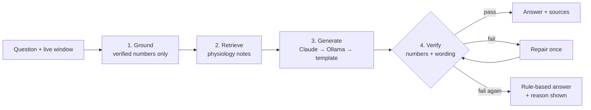
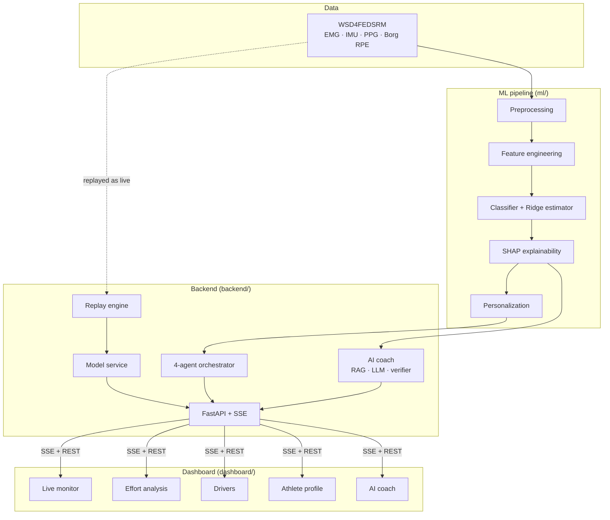

<div align="center">

# 🏃 Athlete Intelligence

### Understand fatigue. Predict it. Explain it.

**A real-time, explainable, personalized muscle-fatigue platform built on wearable EMG · IMU · PPG signals, with an AI coach that shows its evidence and checks its own numbers.**

<p>
  <a href="LICENSE"></a>
  
  
  
  
  
  
</p>

[Why](#why-this-exists) •
[Tech stack](#tech-stack) •
[What's new](#whats-new) •
[Dashboard](#the-dashboard) •
[AI coach](#the-ai-coach) •
[Quick start](#quick-start) •
[Honest results](#honest-results) •
[Architecture](#architecture)

</div>

<br/>

## Why this exists

Fatigue tracking usually boils down to one question asked after the fact: *"How hard did that feel, from 6 to 20?"*

Athlete Intelligence answers it **while the athlete is moving**. It reads muscle activity (EMG), movement quality (IMU) and heart response (PPG), estimates effort with a machine-learning model, explains **why**, adapts to **that athlete's own baseline**, and hands everything to four cooperating agents and an AI coach that turn it into plain advice: *keep going*, *slow down*, or *stop and rest*.

| Who | What they get |
|---|---|
| **Athletes** | A live, honest read on how their body is coping, and the reason behind it |
| **Coaches & trainers** | An early warning before fatigue becomes injury, plus an assistant they can question |
| **Clinicians & ergonomists** | An objective, explainable fatigue signal for rehab and workplace settings |
| **Researchers & engineers** | A reproducible pipeline and a reference design for explainable, agent-orchestrated biosignal AI |

> **Honesty by design.** Every figure on screen comes from a real recording and a real model. Nothing is mocked. When something isn't ready or the backend is down, the interface says so. The effort estimate is a *research-grade guide* (typical error about ±2.3 Borg points) and is labelled that way everywhere.

---

## Tech stack

| Layer | Technology |
|---|---|
| **Language** |     |
| **Machine learning** |    Random Forest · Ridge · 1D-CNN · BiLSTM · TCN · cross-modal attention |
| **Explainability** |  Tree/Linear explainers · attention heatmaps |
| **Data & signals** |    band-pass filtering · windowed features |
| **AI coach (LLM + RAG)** |   local-first fallback · sentence-transformers or TF-IDF retrieval · number-checking guardrail |
| **Backend** |  Uvicorn · Pydantic · Server-Sent Events (live stream) |
| **Frontend** |    vanilla JS, no framework |
| **Quality** |  Git · GitHub |

---

## What's new

This release rebuilt the dashboard and the AI coach end to end.

**Dashboard**
- Fresh, professional layout with calmer typography, tighter spacing and consistent status colours
- Rewritten wording throughout: *Live monitor · Effort analysis · Drivers · Athlete profile · AI coach*, and "Calibrating" instead of "Warming up"
- A **chat-style AI coach** with quick actions, follow-up suggestions, expandable sources and one-click copy
- Borg-zone charts with the **warning (15)** and **stop (18)** levels, plus an alert the moment effort crosses your chosen threshold
- A step-by-step **safety check** (signal quality → personal adjustment → reasons → recommendation)
- **Export report**: a Markdown session summary built only from what the page received
- Keyboard shortcuts, light/dark theme that follows your system, and a layout that works on a phone
- Safer rendering: all server text is escaped before it reaches the page

**AI coach pipeline**
- **Claude backend** (set `ANTHROPIC_API_KEY`) → local **Ollama** → deterministic **rule-based** answers
- **Verify-then-repair:** a draft that quotes an invented number or uses medical wording is sent back once with the exact problem, then falls back to a verified answer if it fails again
- **Honest provenance:** every answer says whether it was AI-written or rule-based, and why a fallback happened
- Intent-aware answers (advice, meaning, reliability, summary, why), conversation memory for follow-ups, and plain-language names instead of feature keys
- Sharper retrieval: everyday phrases like "muscle fibre tiredness" now find the right physiology note
- Bug fixes: the "cure" filter no longer rejects "secure", and `verification_passed` no longer implies an AI answer

**Repo hygiene:** unused template assets and an unreferenced PDF removed; new tests for the coach pipeline and API.

---

## The dashboard

| Tab | What it shows |
|---|---|
| **Live monitor** | Muscle effort versus the athlete's own average, a fatigue marker, their self-rating, exercise progress and an effort trend. Raw EMG/IMU/PPG sits in a collapsed panel |
| **Effort analysis** | Perceived effort on the 6–20 Borg scale beside the athlete's own rating, a zone chart with the 15/18 levels, and the method and typical error in plain words. The first ~30 s of each exercise show "Calibrating" instead of an unvalidated guess |
| **Drivers** | The three biggest signals behind the reading, which way each pushes it, and an *Ask the coach* shortcut. Exact SHAP values are one click away |
| **Athlete profile** | Real age, height and strength, earlier sessions, and how the fatigue likelihood shifts once the athlete's own usual signals are considered |
| **AI coach** | Chat with the explanation layer, plus the four-step safety check with an adjustable warning level |

A summary strip stays visible on every tab: **effort score**, a one-word **status** (Fresh · Working · Fatigued · Critical) and the **coach's latest recommendation**.

**Shortcuts:** `1`–`5` switch tabs · `Space` pause/resume · `/` jump to the coach.

---

## The AI coach



1. **Ground.** A structured summary of the live window (effort, trend, top drivers, deviation from the athlete's usual, signal-quality flags) is the *only* source of numbers.
2. **Retrieve.** The question, with everyday phrases expanded to the knowledge base's vocabulary, selects up to three physiology notes; the most relevant sentence of each becomes its snippet.
3. **Generate.** The first available backend writes a short answer: a custom callable, then **Claude** (`ANTHROPIC_API_KEY`; model via `AI_COACH_MODEL`, default `claude-haiku-5-5`), then local **Ollama**, then a deterministic template. Prompts adapt to the question type and carry earlier turns.
4. **Verify and repair.** Every number must appear in the grounded summary, and diagnostic or treatment wording is rejected. One corrective retry, then the verified template answer, with `fallback_reason` reported.

With no key and no Ollama the coach still works in rule-based mode. The sidebar shows which engine is active.

---

## Quick start

**Prerequisites:** Python 3.10+, Git, and Node.js 18+ *only* if you want to edit the frontend (the API serves the dashboard directly).

```bash
git clone https://github.com/Sangamithraa077/Agentic-Fatigue-Fingerprinting.git
cd Agentic-Fatigue-Fingerprinting
python -m venv venv && source venv/bin/activate      # Windows: venv\Scripts\Activate.ps1
pip install -r requirements.txt
```

**1. Get the data.** Download [WSD4FEDSRM](https://zenodo.org/records/8415066) (CC BY 4.0, not redistributed here) and extract it to `datasets/raw/WSD4FEDSRM/`.

**2. Train the deployed classifier once** (about 45 min on CPU; the checkpoint is too large for GitHub):

```bash
python notebooks/phase9_baseline_models_report.py
```

The Ridge Borg estimator needs no training: its data ships in `ml/models/borg_regression/data/` and each athlete's model fits in under a second.

**3. (Optional) Turn on the AI-written coach**

```bash
export ANTHROPIC_API_KEY=sk-ant-...      # or: pip install ollama  and run an Ollama server
```

**4. Run it**

```bash
uvicorn backend.api.app:app --reload
```

| | |
|---|---|
| **Dashboard** | http://127.0.0.1:8000/dashboard/ |
| API docs (Swagger) | http://127.0.0.1:8000/docs |

Pick an athlete, watch the recorded session replay live, and after ~30 s open **AI coach** to run a safety check or ask a question. First load per athlete can take about a minute: that is the real preprocessing pipeline running, not an animation.

**Frontend hot reload (optional):** `cd dashboard && npm install && npm run dev` (still needs the backend running).

**Run the tests:** `python -m pytest tests/ -v`. A few tests skip when optional components (sentence-transformers, Ollama) aren't installed, and 5 tests that list or replay recordings fail without the dataset (382 pass, 3 skip, with it absent).

### API at a glance

| Endpoint | Purpose |
|---|---|
| `GET /api/replay/subjects` | The athletes available to replay |
| `GET /api/replay/stream/{id}` | SSE stream: one fully computed window at a time |
| `POST /api/agents/analyze` | Run the four agents on the current window (`409` without an open session) |
| `POST /api/rag/explain` | Evidence-grounded answer. Returns `answer`, `source` (`llm`/`template`), `fallback_reason`, `source_details`, `follow_ups`, `verification`. Accepts `history` for follow-ups |
| `GET /api/rag/sources` | The knowledge notes the coach can cite |
| `GET /api/reports/metrics` | Measured evaluation metrics from the research study |
| `GET /api/signals/live/{id}` | Hardware-simulator stream (needs `X-API-Key`; set `FATIGUE_API_KEY`) |
| `GET /api/health` | Status, active AI engine and retrieval backend |

---

## Honest results

**Fatigue classifier** (binary, EMG features, subject-level split). Random Forest is deployed because its SHAP `TreeExplainer` keeps every explanation exact.

| Model | Accuracy | ROC-AUC | F1 |
|---|---|---|---|
| Logistic Regression | 0.560 | 0.570 | 0.540 |
| SVM | 0.588 | 0.563 | 0.547 |
| **Random Forest** (deployed) | 0.625 | 0.586 | 0.561 |
| XGBoost | 0.664 | 0.598 | 0.535 |
| 1D-CNN / BiLSTM / CNN-BiLSTM | 0.660 / 0.659 / 0.660 | 0.574 / 0.568 / 0.575 | 0.479 / 0.487 / 0.449 |
| TCN | 0.672 | 0.604 | 0.536 |

**Borg RPE estimate** (leave-one-participant-out, 34 athletes, 888 sequences):

| Model | MAE (Borg points) | Correlation | Within 1 point |
|---|---|---|---|
| Always guess the training median | **2.18** | n/a | 34.3% |
| **Ridge regression** (deployed) | 2.31 | 0.16 | 22.7% |
| LSTM + attention | 2.48 | 0.09 | 25.9% |

Ridge beats the LSTM and is far steadier across athletes, but **does not beat guessing the average on error**. That is why the dashboard labels every estimate with its method and typical error. Noise added to extracted features made models worse, so augmentation is off by default. Full write-up: [`research/`](research/README.md) and [`reports/`](reports/).

---

## Architecture



**Agents** run in order and short-circuit to a safety report if signal quality fails:

| Agent | Job |
|---|---|
| **Data Intelligence** | Audits the stream for missing channels, NaN/Inf and packet loss |
| **Personalization** | Applies the athlete's own anthropometrics and strength baseline |
| **Explainability** | Turns SHAP attributions into a ranked, readable narrative |
| **Decision & Reporting** | Applies the 15/18 safety thresholds and issues the recommendation |

<details>
<summary><b>Project structure</b></summary>

```
Agentic-Fatigue-Fingerprinting/
├── ml/
│   ├── data_models/           Typed dataset graph (Dataset → Subject → Condition → Sensors)
│   ├── preprocessing/         Loader, EMG/IMU/PPG preprocessors, optional augmentation
│   ├── feature_engineering/   Windowing, extraction, validation, selection
│   ├── models/                classical · deep_learning · borg_regression · proposed
│   ├── explainability/        SHAP explainers, attention visualization
│   ├── personalization/       Subject profiles, LOSO evaluation, similarity
│   ├── rag/                   Retrieval, glossary, number checker, hybrid router
│   └── hardware/              ESP32 packet simulator (sensor-contract testing)
├── backend/                   agents/ · services/ (replay, model) · api/ (FastAPI, SSE)
├── dashboard/                 Browser UI: index.html, src/main.js, src/style.css
├── knowledge/                 Source-tagged physiology, protocol and safety notes
├── research/                  Leave-one-participant-out Borg-RPE study
├── notebooks/ · reports/ · docs/ · tests/ · datasets/ · assets/
```

</details>

<details>
<summary><b>Explainability and personalization details</b></summary>

| Technique | Purpose |
|---|---|
| SHAP | Automatic explainer per model family (exact `TreeExplainer` for Random Forest, `LinearExplainer` for linear models) |
| Attention visualization | Cross-modal attention heatmaps and modality importance |
| Global / local explanations | What matters across a session, and signed contributions for one prediction, live |

| Capability | Description |
|---|---|
| Subject profiles | Real demographic, anthropometric and MVIC strength data per participant |
| Leave-one-subject-out evaluation | Each subject held out against a model trained on everyone else |
| Personalized prediction | Population prediction blended with the athlete's own baseline deviation |
| Similarity analysis | Cosine/Euclidean search for the most similar participants |

</details>

---

## Dataset

Built on **WSD4FEDSRM**, *Wearable Sensor Data for Fatigue Estimation during Shoulder Rotation Movements*: 34 healthy adults doing repeated shoulder rotation to volitional exhaustion, with surface EMG, IMU, finger PPG and self-reported Borg RPE. Distributed by its authors under CC BY 4.0 and not redistributed here. See [`docs/data_model_architecture.md`](docs/data_model_architecture.md).

## Documentation

[`data_model_architecture`](docs/data_model_architecture.md) · [`preprocessing_pipeline`](docs/preprocessing_pipeline.md) · [`feature_engineering`](docs/feature_engineering.md) · [`baseline_models`](docs/baseline_models.md) · [`proposed_model`](docs/proposed_model.md) · [`explainability`](docs/explainability.md) · [`hardware_contract`](docs/hardware_contract.md) · [`research/README`](research/README.md)

## Roadmap

- Live wearable integration (the replay engine is already the seam for it)
- Streaming AI answers, edge deployment, and clinical validation studies
- Federated learning across institutions, a companion mobile app, and CI on every pull request

## Contributing

1. Fork and create a feature branch.
2. Follow the existing architecture: typed dataclasses, structured logging, tests for every new component.
3. Make sure `python -m pytest tests/ -v` passes.
4. Open a pull request describing the change and why. For big changes, open an issue first.

## Acknowledgements

The **WSD4FEDSRM** authors, for a rare public EMG + IMU + PPG dataset with a real exhaustion protocol, and the maintainers of **FastAPI, PyTorch, scikit-learn, SHAP, Chart.js, Lucide and Claude** whose work this stands on.

## License

Code is [MIT](LICENSE). The WSD4FEDSRM dataset is licensed separately under CC BY 4.0 by its authors.

<div align="center">

<br/>

**Built for athletes, coaches and researchers who'd rather understand fatigue than guess at it.**

</div>
