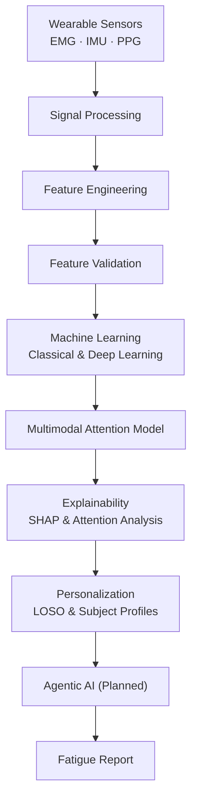
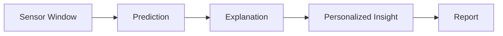

<h1 align="center">Fatigue Fingerprinting</h1>

<p align="center">
  A Multimodal, Explainable, and Personalized AI Framework for Wearable Fatigue Intelligence
</p>

<p align="center">
  <a href="LICENSE"></a>
  <a href="requirements.txt"></a>
</p>

<br/>

## Overview

Fatigue Fingerprinting is a research framework for detecting, explaining, and personalizing muscle fatigue assessment from multimodal wearable sensor data — surface EMG, IMU, and PPG.

Fatigue is conventionally assessed through subjective self-report rather than continuous, objective measurement, and single-sensor approaches capture only part of the picture: EMG reflects local muscular fatigue, while IMU and PPG capture kinematic and cardiovascular signatures that EMG alone misses. Meaningful fatigue intelligence requires fusing these modalities, explaining what drives a given prediction, and accounting for the fact that fatigue tolerance varies substantially between individuals.

This framework addresses all three requirements in a single, cohesive pipeline: signals are cleaned and validated, transformed into biomedically meaningful features, modeled with both classical and attention-based architectures, explained at the feature and modality level, and adapted to the individual through subject-aware evaluation.

| Audience | Use Case |
|---|---|
| Researchers | Wearable-based biomechanics and fatigue physiology |
| Clinicians and ergonomists | Occupational and rehabilitation fatigue risk assessment |
| Sports scientists and trainers | Training load and recovery monitoring |
| ML and AI engineers | Reference architecture for explainable, personalized biomedical time-series modeling |

## Features

| Capability | Description |
|---|---|
| Multimodal Signal Processing | Modality-specific preprocessing pipelines for EMG, IMU, and PPG, each grounded in its own signal characteristics. |
| Fatigue Prediction | Classical (Logistic Regression, SVM, Random Forest, XGBoost) and deep learning (1D-CNN, BiLSTM, CNN-BiLSTM, TCN) models under one shared, leakage-safe evaluation protocol. |
| Cross-Modal Attention Model | A multimodal architecture that fuses EMG, IMU, and PPG representations through multi-head cross-modal attention, with interchangeable fusion strategies. |
| Explainable AI | SHAP-based feature attribution with automatic explainer selection, alongside attention-weight analysis, producing both global and local explanations. |
| Personalized Intelligence | Subject-level baseline profiling, Leave-One-Subject-Out evaluation, and a personalization layer that adapts population-level predictions to the individual. |
| Subject-Aware Evaluation | Every data split — cross-validation, train/validation/test, and LOSO — is grouped by subject to prevent leakage across correlated windows. |
| Modular Architecture | Typed, dataclass-driven components with a consistent configuration pattern, independently reusable across the pipeline. |
| Reproducible Reporting | Every analysis stage produces a Markdown report with figures, generated directly from a runnable script rather than written by hand. |

## Architecture

The framework processes sensor data through a linear pipeline, from raw signal to a personalized, explainable fatigue assessment.



Each stage is an independent, reusable module: models can be explained without retraining, and predictions can be personalized without modifying the underlying model. The agentic orchestration stage is discussed in [Agentic AI Architecture](#agentic-ai-architecture).

## Repository Structure

```
Agentic-Fatigue-Fingerprinting/
├── ml/
│   ├── data_models/           Typed dataset object graph (Dataset → Subject → Condition → Sensors)
│   ├── preprocessing/         Dataset loader and EMG/IMU/PPG signal preprocessors
│   ├── feature_engineering/   Windowing, feature extraction, validation, and selection
│   ├── models/
│   │   ├── common/            Shared configuration, dataset builder, group-aware splitting, metrics
│   │   ├── classical/         Logistic Regression, SVM, Random Forest, XGBoost
│   │   ├── deep_learning/     1D-CNN, BiLSTM, CNN-BiLSTM, TCN
│   │   └── proposed/          Multimodal cross-modal attention architecture
│   ├── explainability/        SHAP explainers, attention visualization, report generation
│   └── personalization/       Subject profiles, LOSO evaluation, personalized prediction, similarity
├── notebooks/                 Runnable, reproducible pipeline and report scripts
├── reports/                   Generated Markdown reports and figures
├── docs/                      Design-rationale documentation per module
├── tests/                     Unit test suite (pytest)
├── backend/                   Planned: API, services, database, agentic components
├── dashboard/                 Planned: interactive visualization frontend
├── datasets/                  Raw and processed data (not version-controlled)
└── assets/                    Diagrams and images
```

## Dataset

The framework is built and validated on **WSD4FEDSRM** — *Wearable Sensor Data for Fatigue Estimation during Shoulder Rotation Movements*.

- **Participants** — 34 healthy adults performing repeated shoulder rotation to volitional exhaustion under a controlled load protocol.
- **Sensors** — surface EMG across six muscles, IMU across six body locations, and finger PPG, alongside self-reported Borg RPE fatigue scores.
- **Rationale** — one of the few public datasets combining muscular, kinematic, and cardiovascular signals against a genuine exhaustion protocol, matching the exact multimodal scope this framework is built to fuse and explain.
- **License** — distributed separately under CC BY 4.0 by its original authors and not redistributed in this repository. See [`docs/data_model_architecture.md`](docs/data_model_architecture.md) for how it is loaded, and [Installation](#installation) for how to obtain it.

## Machine Learning Pipeline

| Stage | Description |
|---|---|
| Signal Preprocessing | Modality-specific cleaning: EMG band-pass filtering and rectification, IMU gap-filling and consistency checks, PPG baseline-drift removal and smoothing. |
| Feature Engineering | Configurable sliding-window extraction: time- and frequency-domain EMG features, per-axis and resultant-vector IMU features, and peak-based PPG features. |
| Feature Validation | Automated detection of missing, infinite, constant, near-zero-variance, and highly correlated features, with mutual-information and variance-based selection diagnostics. |
| Benchmark Models | Four classical and four deep learning architectures, trained and evaluated under one identical, group-aware protocol for direct comparability. |
| Multimodal Attention Architecture | Independent per-modality encoders project EMG, IMU, and PPG into a shared embedding space, combined through a configurable fusion module — multi-head cross-modal attention, concatenation, or weighted sum. |

## Explainability

Every prediction can be examined at both the population and individual level.

| Technique | Purpose |
|---|---|
| SHAP | Automatic explainer selection per model family — exact `TreeExplainer` for Random Forest and XGBoost, `LinearExplainer` for Logistic Regression — producing summary, beeswarm, waterfall, force, and dependence plots. |
| Attention Visualization | Cross-modal attention weights from the multimodal architecture, surfaced as heatmaps, modality-importance scores, and attention-weight distributions. |
| Global Explanations | Dataset-level feature importance, aggregated across many predictions. |
| Local Explanations | Signed, per-feature contributions for a single prediction. |

Interpretability is a first-class output rather than an auxiliary feature: it is what allows a prediction to be trusted and audited, rather than treated as the output of an opaque model.

## Personalization

Population-level models generalize on average but miss individual variability in muscle activation, body composition, and fatigue tolerance.

| Capability | Description |
|---|---|
| Subject Profiles | Per-participant demographic, anthropometric, baseline sensor, and fatigue-history summaries. |
| Leave-One-Subject-Out Evaluation | Each subject is held out and evaluated against a model trained on everyone else — the standard, leakage-free measure of generalization to a new individual. |
| Personalized Prediction | A population-level prediction is blended with a subject-specific baseline-deviation signal, adapting the output to that individual's own sensor profile. |
| Similarity Analysis | Configurable cosine or Euclidean similarity search over subject profiles, identifying the most physiologically similar participants. |

## Agentic AI Architecture

**Planned.** The agents below describe the orchestration layer this framework is designed to support, built on top of the modeling, explainability, and personalization modules described above. They are not yet implemented.

| Agent | Responsibility |
|---|---|
| Data Intelligence Agent | Orchestrates data ingestion, preprocessing, and feature extraction, and flags signal-quality issues before they reach modeling. |
| Explainability Agent | Generates and interprets SHAP and attention-based explanations, translating raw attributions into human-readable rationale. |
| Personalization Agent | Maintains subject profiles, applies LOSO-informed personalization, and reasons over subject similarity to contextualize an individual's result. |
| Decision and Reporting Agent | Synthesizes model output, explanation, and personalization context into a final fatigue assessment and narrative report. |

## Installation

Requires Python 3.10 or later.

```bash
git clone https://github.com/Sangamithraa077/Agentic-Fatigue-Fingerprinting.git
cd Agentic-Fatigue-Fingerprinting

python -m venv venv
source venv/bin/activate      # On Windows: venv\Scripts\activate

pip install -r requirements.txt
```

Download the [WSD4FEDSRM dataset](https://zenodo.org/records/8415066) and extract it to `datasets/raw/WSD4FEDSRM/`.

## Usage

Each pipeline stage is exposed as a reusable Python module under `ml/`, with a runnable, reproducible entry point under `notebooks/`. Running a script loads and preprocesses the raw sensor data, extracts and validates features, trains or reloads the relevant model, and writes a Markdown report with figures to `reports/`. No report is written by hand — each is the direct, reproducible output of its corresponding script.

```bash
# Load the raw dataset into the typed object model
python -m ml.preprocessing.dataset_loader

# Run the baseline modeling pipeline
python notebooks/phase9_baseline_models_report.py

# Run the explainability pipeline
python notebooks/phase11_explainability_report.py

# Run the personalization pipeline
python notebooks/phase12_personalization_report.py

# Run the test suite
python -m pytest tests/ -v
```

### Example Workflow



A raw EMG, IMU, or PPG window is scored by a trained model, explained through SHAP or attention analysis, adjusted using the subject's own baseline profile, and summarized into a reproducible report.

## Technology Stack

| Category | Tools |
|---|---|
| Language | Python 3.10+ |
| Machine Learning | scikit-learn, XGBoost |
| Deep Learning | PyTorch |
| Explainable AI | SHAP |
| Data Processing | NumPy, SciPy, pandas |
| Visualization | Matplotlib, Seaborn |
| Testing | pytest |
| Version Control | Git, GitHub |

## Future Enhancements

- Real-time wearable device integration
- Edge deployment for on-device inference
- Clinical validation studies
- Federated learning across institutions
- Companion mobile application
- Full implementation of the agentic orchestration layer
- Interactive visualization dashboard

## Contributing

Contributions are welcome.

1. Fork the repository and create a feature branch.
2. Follow the existing architecture — typed dataclasses, structured logging, and unit tests for every new component.
3. Ensure `python -m pytest tests/ -v` passes before opening a pull request.
4. Open a pull request with a clear description of the change and its motivation.

For substantial changes, open an issue first to discuss the proposed direction.

## License

This project's code is licensed under the [MIT License](LICENSE). The WSD4FEDSRM dataset is licensed separately under CC BY 4.0 by its original authors and is not redistributed in this repository.
