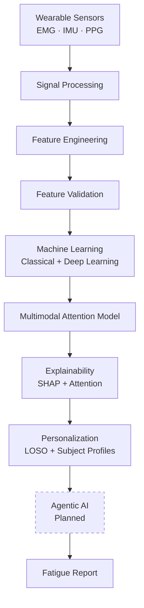
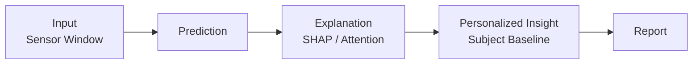

# Agentic Fatigue Fingerprinting

**A Multimodal, Explainable, and Personalized AI Framework for Wearable-Based Fatigue Intelligence**

[](LICENSE)
[](requirements.txt)

---

## Project Overview

**Agentic Fatigue Fingerprinting** is a research-grade AI framework for detecting, explaining, and personalizing muscle fatigue assessment from multimodal wearable sensor data — surface EMG, IMU, and PPG.

Fatigue is a leading contributor to musculoskeletal injury, reduced work performance, and impaired motor control, yet it is typically assessed through subjective self-report (e.g. the Borg RPE scale) rather than continuous, objective, sensor-derived signals. Single-sensor approaches also fall short: EMG alone misses systemic (cardiovascular) fatigue signatures, while motion or pulse data alone miss localized muscular fatigue. Fusing multiple modalities — and doing so in a way that is both explainable and adapted to the individual — is what makes fatigue intelligence clinically and practically trustworthy.

This framework addresses that gap end-to-end: raw multimodal signals are cleaned and validated, transformed into biomedically meaningful features, modeled with both classical and attention-based deep learning architectures, explained at both the feature and modality level, and adapted to individual subjects through personalized evaluation.

**Who benefits:**
- **Researchers** studying wearable-based biomechanics and fatigue physiology.
- **Clinicians & ergonomists** assessing occupational or rehabilitation fatigue risk.
- **Sports scientists & athletic trainers** monitoring load and recovery.
- **ML/AI engineers** looking for a reference architecture for explainable, personalized biomedical time-series modeling.

---

## Key Features

| Capability | Description |
|---|---|
| 🧬 **Multimodal Biomedical Signal Processing** | Modality-specific preprocessing for EMG, IMU, and PPG, each with its own biomedically-motivated cleaning and filtering pipeline. |
| 📈 **Fatigue Prediction** | Classical (Logistic Regression, SVM, Random Forest, XGBoost) and deep learning (1D-CNN, BiLSTM, CNN-BiLSTM, TCN) benchmarks under a shared, leakage-safe evaluation protocol. |
| 🧠 **Cross-Modal Attention Model** | A proposed multimodal architecture that fuses EMG, IMU, and PPG representations via multi-head cross-modal attention, with configurable fusion strategies. |
| 🔍 **Explainable AI** | SHAP-based feature attribution (automatic tree/linear explainer selection) and attention-weight analysis, producing global and local explanations. |
| 🎯 **Personalized Intelligence** | Subject-level baseline profiling, Leave-One-Subject-Out (LOSO) evaluation, and a personalization layer that adapts population-level predictions to the individual. |
| 👥 **Subject-Aware Evaluation** | Every split — cross-validation, train/val/test, and LOSO — is group-aware by subject, preventing data leakage across correlated windows. |
| 🧩 **Modular AI Framework** | Fully typed, dataclass-driven components with a consistent configuration pattern, independently reusable across the pipeline. |
| 📄 **Automated Report Generation** | Every analysis stage produces a reproducible Markdown report with figures, generated directly from a runnable script — not hand-written. |

---

## System Architecture



> The **Agentic AI** stage is a planned orchestration layer — see [Agentic AI Architecture](#agentic-ai-architecture).

---

## Project Structure

```
Agentic-Fatigue-Fingerprinting/
├── ml/
│   ├── data_models/           # Typed dataset object graph (Dataset → Subject → Condition → Sensors)
│   ├── preprocessing/         # Dataset loader + EMG/IMU/PPG signal preprocessors
│   ├── feature_engineering/   # Windowing, feature extraction, validation, and selection
│   ├── models/
│   │   ├── common/            # Shared config, dataset builder, group-aware splitting, metrics
│   │   ├── classical/         # Logistic Regression, SVM, Random Forest, XGBoost
│   │   ├── deep_learning/     # 1D-CNN, BiLSTM, CNN-BiLSTM, TCN
│   │   └── proposed/          # Multimodal cross-modal attention architecture
│   ├── explainability/        # SHAP explainers, attention visualization, report generation
│   └── personalization/       # Subject profiles, LOSO evaluation, personalized prediction, similarity
├── notebooks/                 # Runnable, reproducible pipeline/report scripts
├── reports/                   # Generated Markdown reports + figures
├── docs/                      # Design-rationale documentation per module
├── tests/                     # Unit test suite (pytest)
├── backend/                   # Planned: API, services, database, agentic components
├── dashboard/                 # Planned: interactive visualization frontend
├── datasets/                  # Raw/processed data (gitignored)
└── assets/                    # Diagrams and images
```

---

## Dataset

This framework is built and validated on **WSD4FEDSRM** — *Wearable Sensor Data for Fatigue Estimation during Shoulder Rotation Movements*.

- **Participants:** 34 healthy adults performing repeated shoulder rotation until volitional exhaustion, under a controlled load protocol.
- **Sensors:** surface EMG (6 muscles), IMU (6 body locations), and PPG (finger), each sampled at sensor-appropriate rates, alongside self-reported Borg RPE fatigue scores.
- **Why this dataset:** it is one of the few publicly available datasets combining muscular (EMG), kinematic (IMU), and cardiovascular (PPG) signals against a real fatigue protocol taken to genuine exhaustion — the exact multimodal combination this framework is designed to fuse and explain.
- **License:** the dataset is distributed separately under **CC BY 4.0** by its original authors and is **not redistributed** in this repository. See [`docs/data_model_architecture.md`](docs/data_model_architecture.md) for how it is loaded, and [Installation](#installation) for how to obtain it.

---

## Machine Learning Pipeline

**1. Signal Preprocessing** — modality-specific cleaning: EMG band-pass filtering and rectification, IMU gap-filling and consistency checks, PPG baseline-drift removal and smoothing.

**2. Feature Engineering** — configurable sliding-window extraction: time- and frequency-domain EMG features, per-axis and resultant-vector IMU features, and peak-based PPG features.

**3. Feature Validation** — automated checks for missing, infinite, constant, near-zero-variance, and highly correlated features, plus mutual-information and variance-based selection diagnostics.

**4. Benchmark Models** — four classical (Logistic Regression, SVM, Random Forest, XGBoost) and four deep learning (1D-CNN, BiLSTM, CNN-BiLSTM, TCN) architectures, trained and evaluated under one identical, group-aware protocol so results are directly comparable.

**5. Proposed Multimodal Attention Architecture** — independent modality encoders for EMG, IMU, and PPG project each signal into a shared embedding space; a configurable fusion module (multi-head cross-modal attention, concatenation, or weighted sum) combines them into one representation for classification.

---

## Explainable AI

Every prediction in this framework can be explained at two levels:

- **SHAP (Shapley Additive Explanations):** automatic explainer selection per model family — exact `TreeExplainer` for Random Forest/XGBoost, `LinearExplainer` for Logistic Regression — producing summary, beeswarm, waterfall, force, and dependence plots.
- **Attention Visualization:** cross-modal attention weights from the proposed architecture are surfaced as heatmaps, modality-importance scores, and attention-weight distributions.
- **Global Explanations:** dataset-level feature importance rankings, aggregated across many predictions.
- **Local Explanations:** per-sample, signed feature contributions for individual predictions — "why did the model predict this, for this window?"

Interpretability is treated as a first-class output, not an afterthought: explanations are what let a clinician, researcher, or engineer trust — and audit — a fatigue prediction rather than treat the model as a black box.

---

## Personalized Fatigue Intelligence

Population-level models generalize on average but miss individual variability in muscle activation, body composition, and fatigue tolerance. This framework's personalization layer addresses that directly:

- **Subject Profiles** — per-participant demographic, anthropometric, baseline sensor statistics, and fatigue-history summaries.
- **Leave-One-Subject-Out (LOSO) Evaluation** — every subject is held out and evaluated against a model trained on everyone else, the honest way to measure generalization to a new individual.
- **Personalized Prediction** — a population-level prediction is blended with a subject-specific baseline-deviation signal, adapting the output to that individual's own sensor profile.
- **Similarity Analysis** — configurable cosine or Euclidean similarity search over subject profiles, surfacing the most physiologically similar participants.

---

## Agentic AI Architecture

> **Planned Architecture.** The components below describe the intended orchestration layer this framework is designed to support. They are **not yet implemented** — the modeling, explainability, and personalization modules described above already produce the structured outputs (predictions, SHAP/attention explanations, personalized scores, similarity results) these agents are designed to consume.

| Agent | Responsibility |
|---|---|
| **1. Data Intelligence Agent** | Orchestrates data ingestion, preprocessing, and feature extraction; monitors signal quality and flags anomalies before they reach modeling. |
| **2. Explainability Agent** | Generates and interprets SHAP and attention-based explanations for a given prediction, translating raw attributions into human-readable rationale. |
| **3. Personalization Agent** | Maintains subject profiles, applies LOSO-informed personalization, and reasons over subject similarity to contextualize an individual's result. |
| **4. Decision & Reporting Agent** | Synthesizes model output, explanation, and personalization context into a final fatigue assessment and natural-language report. |

---

## Installation

Requires **Python 3.10+**.

```bash
git clone https://github.com/Sangamithraa077/Agentic-Fatigue-Fingerprinting.git
cd Agentic-Fatigue-Fingerprinting

python -m venv venv
source venv/bin/activate      # On Windows: venv\Scripts\activate

pip install -r requirements.txt
```

Then download the [WSD4FEDSRM dataset](https://zenodo.org/records/8415066) and extract it to `datasets/raw/WSD4FEDSRM/`.

---

## Quick Start

```bash
# Load the raw dataset into the typed object model
python -m ml.preprocessing.dataset_loader

# Run the baseline modeling pipeline end-to-end
python notebooks/phase9_baseline_models_report.py

# Run the explainability pipeline (SHAP + attention analysis)
python notebooks/phase11_explainability_report.py

# Run the personalization pipeline (LOSO + subject profiling)
python notebooks/phase12_personalization_report.py

# Run the full test suite
python -m pytest tests/ -v
```

---

## Usage

Every pipeline stage — preprocessing, feature engineering, modeling, explainability, personalization — is exposed as a **reusable Python module** under `ml/`, and every stage's runnable, reproducible entry point lives under `notebooks/`. Running a script:

1. Loads and preprocesses the raw sensor data.
2. Extracts and validates features.
3. Trains or reloads the relevant model(s).
4. Generates a Markdown report with figures under `reports/`.

Nothing under `reports/` is hand-written — each report is the direct, reproducible output of its corresponding script, so results can always be regenerated and verified.

---

## Example Workflow



A raw EMG/IMU/PPG window is scored by a trained model, explained via SHAP or attention analysis, adjusted using the subject's own baseline profile, and summarized into a reproducible report.

---

## Technologies Used

| Category | Tools |
|---|---|
| **Programming Language** | Python 3.10+ |
| **Machine Learning** | scikit-learn, XGBoost |
| **Deep Learning** | PyTorch |
| **Explainable AI** | SHAP |
| **Data Processing** | NumPy, SciPy, pandas |
| **Visualization** | Matplotlib, Seaborn |
| **Testing** | pytest |
| **Development Tools** | Type-hinted dataclasses, structured logging |
| **Version Control** | Git & GitHub |

---

## Repository Highlights

- **Modular architecture** — every stage (preprocessing, features, modeling, explainability, personalization) is an independently testable, typed Python package.
- **Reusable pipelines** — shared configuration, dataset-building, and evaluation utilities are used unmodified across classical, deep learning, and multimodal models.
- **Comprehensive unit testing** — 274 automated tests across every module.
- **Reproducibility** — every report and figure is generated by a runnable script, never hand-written.
- **Documentation** — design-rationale docs under [`docs/`](docs/) explain *why*, not just *what*, alongside full API documentation in module docstrings.

---

## Future Enhancements

- 🔌 Real-time wearable device integration
- 📱 Edge deployment for on-device inference
- 🏥 Clinical validation studies
- 🌐 Federated learning across institutions
- 📲 Companion mobile application
- 🤖 Full implementation of the agentic orchestration layer
- 📊 Interactive visualization dashboard

---

## Contributing

Contributions are welcome.

1. Fork the repository and create a feature branch.
2. Follow the existing architecture: typed dataclasses, structured logging, and unit tests for every new component.
3. Ensure `python -m pytest tests/ -v` passes before opening a pull request.
4. Open a pull request with a clear description of the change and its motivation.

For substantial changes, please open an issue first to discuss the proposed direction.

---

## License

This project's code is licensed under the [MIT License](LICENSE). The WSD4FEDSRM dataset is licensed separately under **CC BY 4.0** by its original authors and is not redistributed in this repository.

---

## Author

**Sangamithraa Senthil**
Author & Maintainer
[github.com/Sangamithraa077](https://github.com/Sangamithraa077)
