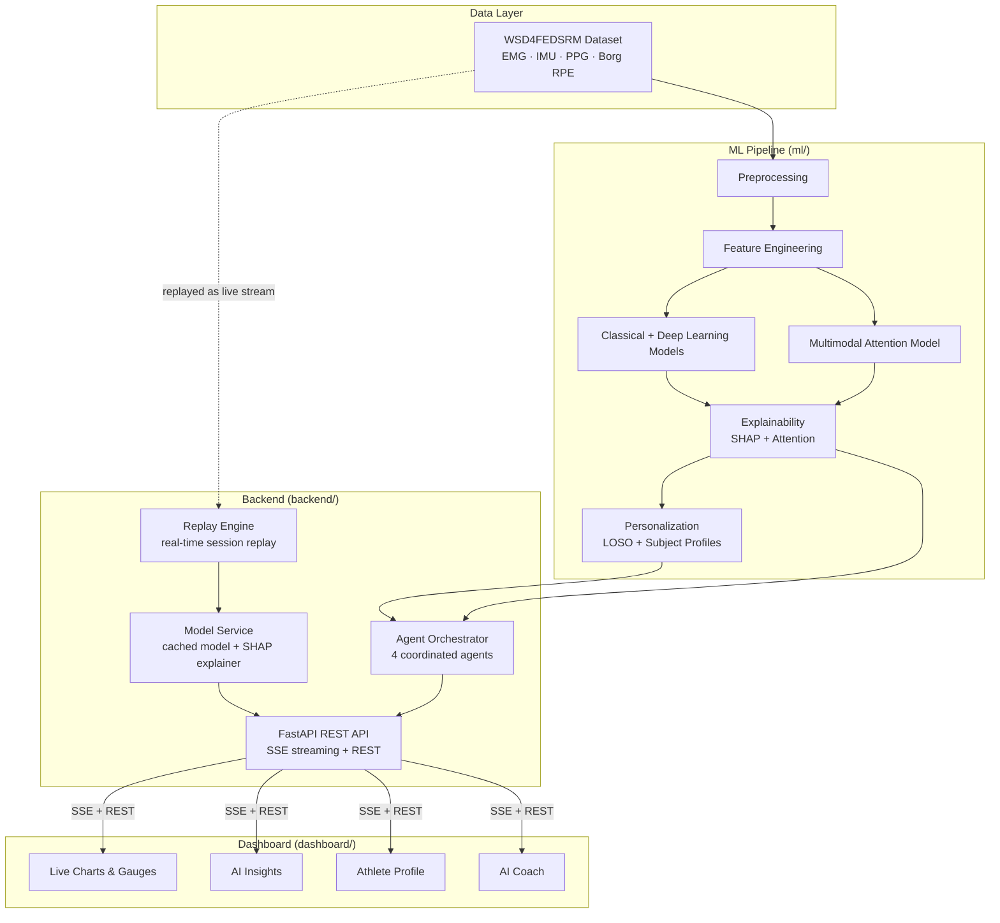
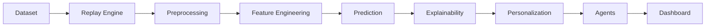

<div align="center">

# Athlete Intelligence

### Understand. Predict. Perform.

**A real-time, explainable, and personalized AI platform for muscle fatigue intelligence —
built on multimodal wearable sensor data (EMG · IMU · PPG).**

<p>
  <a href="LICENSE"></a>
  <a href="requirements.txt"></a>
  <a href="dashboard/package.json"></a>
  
  <a href="https://github.com/Sangamithraa077/Agentic-Fatigue-Fingerprinting/graphs/contributors"></a>
  
</p>

[Overview](#overview) •
[Features](#key-features) •
[Dashboard](#dashboard-showcase) •
[Architecture](#architecture) •
[Installation](#installation) •
[Documentation](#documentation-index)

</div>

<br/>

## Overview

Most fatigue tracking today comes down to one question, asked after the fact: *"How hard did that feel, on a scale of 1 to 20?"*

**Athlete Intelligence** takes a different approach. It reads real physiological signals — muscle activity (EMG), movement quality (IMU), and heart response (PPG) — while an athlete is training, runs them through a trained machine learning model, explains *why* the model reached its conclusion, adjusts the result to that specific athlete's own body and strength baseline, and hands the whole thing to a team of coordinated AI agents that turn it into a plain-language coaching recommendation.

It's built for anyone who needs to understand fatigue as it happens, not after the fact:

| Who | What they get |
|---|---|
| **Athletes** | A live, honest read on how their body is handling a session — not just a number, but *why*. |
| **Coaches & trainers** | An AI assistant that flags rising fatigue risk before it becomes an injury. |
| **Clinicians & ergonomists** | Objective, explainable fatigue signal for occupational and rehab settings. |
| **Researchers** | A full, reproducible ML pipeline — preprocessing through personalization — built on real wearable sensor data. |
| **Engineers** | A reference architecture for explainable, personalized, agent-orchestrated biomedical time-series AI. |

Every number on the dashboard is real. There is no synthetic data, no mocked prediction, and no fallback simulation anywhere in the live product — if the backend is unreachable, the interface says so, honestly, instead of making something up.

---

## Key Features

**AI & Machine Learning**
- Classical (Logistic Regression, SVM, Random Forest, XGBoost) and deep learning (1D-CNN, BiLSTM, CNN-BiLSTM, TCN) fatigue models, benchmarked under one identical, leakage-safe evaluation protocol
- A multimodal cross-modal attention architecture that fuses EMG, IMU, and PPG into a single shared representation
- On-the-fly in-memory training data augmentation (Gaussian noise jittering, magnitude scaling, and time warping) to combat overfitting without disk overhead or data leakage
- Epistemic uncertainty quantification via Monte Carlo Dropout (50 stochastic forward passes generating 95% confidence intervals on the Borg RPE scale)
- SHAP-based explainability — global and local feature attribution, with automatic explainer selection per model family
- Personalization layer — Leave-One-Subject-Out evaluation and subject-specific baseline adjustment, so the model adapts to *this* athlete, not just "the average one"
- A 4-agent orchestration layer (Data Intelligence, Personalization, Explainability, Decision & Reporting) that synthesizes every stage above into one coaching recommendation

**Live Product**
- Real-time signal replay engine — streams an athlete's actual recorded session progressively, exactly as if a live sensor were attached, with the architecture already designed as a drop-in seam for a real sensor later
- **AI Coach** — a structured recommendation (Priority · Confidence · Recovery Outlook · Suggested Action) built directly from real agent output, not a canned response
- Dark & light themes, fully re-tinted design system, persisted per user
- Live-updating charts, HUD-style performance rings, and a skill radar — all driven by the same real payload, perfectly in sync across every tab
- Accessible by default — focus states, `aria-live` regions, reduced-motion support

---

## Dashboard Showcase

The dashboard is organized around one continuous story — not five disconnected screens:

| Tab | What it shows |
|---|---|
| **Live Performance** | Real EMG/IMU/PPG signals, streamed progressively from the athlete's recorded session |
| **Performance Score** | A live, human-friendly read on how the body is handling the session right now |
| **AI Insights** | Why the model reached this conclusion — visual, ranked, plain-language, with technical SHAP values available on demand |
| **Athlete Profile** | A player-card view of real demographics, strength baseline, and a skill radar |
| **AI Coach** | A live check-in with the real 4-agent backend — Priority, Confidence, Recovery Outlook, and a Suggested Action |

A persistent hero strip keeps **Performance**, **Fatigue Status**, and the latest **AI Recommendation** visible no matter which tab is open, so the athlete's current state is never more than a glance away.

> **Screenshots**: this repository ships without pre-rendered screenshots (`assets/images/` is present but empty by design — nothing here is stock photography). Run the dashboard locally (see [Installation](#installation)) to see it live in under five minutes, or drop your own captures into `assets/images/` and link them here.

---

## Architecture



Each stage is independently reusable: a model can be explained without retraining, a prediction can be personalized without touching the model, and the replay engine is deliberately built as the seam a real physical sensor would plug into later — see [`backend/services/replay_engine.py`](backend/services/replay_engine.py) for that design note in context.

---

## AI Pipeline

The exact flow a single window of sensor data travels, from raw recording to a coaching recommendation on screen:



1. **Dataset** — real WSD4FEDSRM recordings for the selected athlete
2. **Replay Engine** — streams that athlete's session forward progressively, one live-looking window at a time
3. **Preprocessing** — the same modality-specific cleaning used throughout the ML pipeline (band-pass filtering, gap-filling, drift removal)
4. **Feature Engineering** — sliding-window time/frequency-domain feature extraction
5. **Prediction** — the trained Random Forest classifier scores the current window
6. **Explainability** — the SHAP `TreeExplainer` attributes the prediction to specific features
7. **Personalization** — the prediction is adjusted using this athlete's own strength baseline
8. **Agents** — four agents turn all of the above into one coherent recommendation
9. **Dashboard** — every tab updates from this exact same computed window, in sync

---

## Agent Framework

| Agent | Responsibility |
|---|---|
| **Data Intelligence Agent** | Audits the live signal stream for missing channels, NaN/Inf artifacts, or packet loss before anything downstream trusts it |
| **Personalization Agent** | Applies this athlete's real anthropometrics and MVIC strength baseline to the population-level prediction |
| **Explainability Agent** | Translates the real SHAP attribution vector into a ranked, human-readable narrative |
| **Decision & Reporting Agent** | Enforces the safety threshold and synthesizes every upstream agent's output into one final recommendation |

`AgentOrchestrator` runs all four sequentially — Data Intelligence → Personalization → Explainability → Decision & Reporting — and short-circuits straight to a safety report if the Data Intelligence Agent rejects the incoming signal.

The agents run against **live inference from the real trained model and replay engine** — every check-in from the dashboard's AI Coach tab triggers a genuine run of this pipeline over the athlete's current window; nothing is templated or replayed from a fixture.

---

## Project Structure

```
Agentic-Fatigue-Fingerprinting/
├── ml/
│   ├── data_models/           Typed dataset object graph (Dataset → Subject → Condition → Sensors)
│   ├── preprocessing/         Dataset loader, EMG/IMU/PPG signal preprocessors, and in-memory data augmentation
│   ├── feature_engineering/   Windowing, feature extraction, validation, and selection
│   ├── models/
│   │   ├── common/            Shared configuration, dataset builder, group-aware splitting, metrics
│   │   ├── classical/         Logistic Regression, SVM, Random Forest, XGBoost
│   │   ├── deep_learning/     1D-CNN, BiLSTM, CNN-BiLSTM, TCN
│   │   └── proposed/          Multimodal cross-modal attention architecture
│   ├── explainability/        SHAP explainers, attention visualization, report generation
│   └── personalization/       Subject profiles, LOSO evaluation, personalized prediction, similarity
├── backend/
│   ├── agents/                 Data Intelligence, Personalization, Explainability, Decision/Reporting agents + orchestrator
│   ├── services/                Replay engine (live session streaming) and cached model/SHAP service
│   └── api/                    FastAPI app, REST routes, and the real-time SSE replay endpoint
├── dashboard/                  Athlete Intelligence — the live browser dashboard (Vite + Chart.js + Lucide)
│   └── src/                     main.js (data + interaction layer), style.css (design system)
├── notebooks/                  Runnable, reproducible pipeline and report scripts
├── reports/                    Generated Markdown reports and figures (real benchmark output)
├── docs/                       Design-rationale documentation per module
├── tests/                      pytest suite (345+ passing tests)
├── datasets/                   Raw and processed data (not version-controlled)
└── assets/                     Diagrams and images
```

---

## Installation

**Prerequisites**

| Requirement | Needed for |
|---|---|
| Python 3.10+ | The ML pipeline, explainability, personalization, agents, and API |
| Node.js 18+ | Building the dashboard from source (optional — the API serves a prebuilt copy directly) |
| Git | Cloning the repository |

**1. Clone the repository**

```bash
git clone https://github.com/Sangamithraa077/Agentic-Fatigue-Fingerprinting.git
cd Agentic-Fatigue-Fingerprinting
```

**2. Create and activate a virtual environment**

```bash
python -m venv venv
```

```bash
# macOS / Linux
source venv/bin/activate

# Windows (PowerShell)
venv\Scripts\Activate.ps1
```

**3. Install Python dependencies**

```bash
pip install -r requirements.txt
```

**4. Download the dataset**

Download [WSD4FEDSRM](https://zenodo.org/records/8415066) from Zenodo and extract it so the raw files live at:

```
datasets/raw/WSD4FEDSRM/
```

**5. Verify the installation**

```bash
python -m pytest tests/ -v
```

All 345+ tests should pass — if they do, the environment is ready.

---

## Running the Backend

```bash
uvicorn backend.api.app:app --reload
```

| | |
|---|---|
| API root | `http://127.0.0.1:8000` |
| Interactive API docs (Swagger) | `http://127.0.0.1:8000/docs` |
| **Dashboard** | `http://127.0.0.1:8000/dashboard/` |

The backend also serves the dashboard directly — you don't need Node.js installed just to use the product.

## Running the Dashboard (frontend dev mode)

Only needed if you're actively editing the dashboard's frontend code and want hot reload:

```bash
cd dashboard
npm install
npm run dev
```

Vite prints a local dev URL (typically `http://localhost:5173`). It still expects the FastAPI backend above to be running, since that's where all the real data comes from.

## Running the Test Suite

```bash
python -m pytest tests/ -v
```

---

## Demo

There's no hosted demo — the product replays real, non-public sensor recordings, so the honest way to see it is to run it yourself:

1. Start the backend (`uvicorn backend.api.app:app --reload`)
2. Open `http://127.0.0.1:8000/dashboard/`
3. Pick any of the 34 available athletes from the sidebar
4. Watch their real recorded session replay live across every tab
5. Open **AI Coach** and click **Check In With Coach** for a live, real 4-agent assessment

First load for a given athlete takes up to about a minute — that's the real preprocessing and feature-extraction pipeline running over their actual recording, not a loading animation for its own sake.

---

## Dataset

Built and validated on **WSD4FEDSRM** — *Wearable Sensor Data for Fatigue Estimation during Shoulder Rotation Movements*.

- **Participants** — 34 healthy adults performing repeated shoulder rotation to volitional exhaustion under a controlled load protocol
- **Sensors** — surface EMG across six muscles, IMU across six body locations, and finger PPG, alongside self-reported Borg RPE fatigue scores
- **Why this dataset** — one of the few public datasets combining muscular, kinematic, and cardiovascular signals against a genuine exhaustion protocol, matching the exact multimodal scope this platform fuses and explains
- **License** — distributed separately under CC BY 4.0 by its original authors and not redistributed in this repository. See [`docs/data_model_architecture.md`](docs/data_model_architecture.md) for how it's loaded.

---

## Model Details

Four classical and four deep learning models were benchmarked under one identical, group-aware (subject-level) evaluation protocol on EMG features, binary fatigue classification:

| Model | Category | Accuracy | ROC-AUC | F1 |
|---|---|---|---|---|
| Logistic Regression | classical | 0.560 | 0.570 | 0.540 |
| SVM | classical | 0.588 | 0.563 | 0.547 |
| **Random Forest** | classical | 0.625 | 0.586 | 0.561 |
| XGBoost | classical | 0.664 | 0.598 | 0.535 |
| 1D-CNN | deep learning | 0.660 | 0.574 | 0.479 |
| BiLSTM | deep learning | 0.659 | 0.568 | 0.487 |
| CNN-BiLSTM | deep learning | 0.660 | 0.575 | 0.449 |
| TCN | deep learning | 0.672 | 0.604 | 0.536 |

**Random Forest is the model actually deployed** in the live dashboard and agent pipeline — chosen for its exact SHAP `TreeExplainer` compatibility, which keeps every explanation shown to an athlete mathematically exact rather than approximated. Full methodology, all feature-subset comparisons, and figures are in [`reports/baseline_models_report.md`](reports/baseline_models_report.md).

---

## Explainability

| Technique | Purpose |
|---|---|
| SHAP | Automatic explainer selection per model family — exact `TreeExplainer` for the deployed Random Forest, `LinearExplainer` for linear models |
| Attention Visualization | Cross-modal attention weights from the multimodal architecture, as heatmaps and modality-importance scores |
| Global Explanations | Which features matter most across this athlete's entire session |
| Local Explanations | Signed, per-feature contributions for one specific prediction, live |

In the dashboard, this becomes the **AI Insights** tab: plain-language "what influenced this" first, exact SHAP numbers one click away in a collapsed technical-details panel — never hidden, never the first thing you see.

---

## Personalization

| Capability | Description |
|---|---|
| Subject Profiles | Real per-participant demographic, anthropometric, and MVIC strength baseline data |
| Leave-One-Subject-Out Evaluation | Each subject held out and evaluated against a model trained on everyone else — the standard leakage-free measure of generalizing to a new individual |
| Personalized Prediction | The population-level prediction blended with this athlete's own baseline deviation |
| Similarity Analysis | Configurable cosine/Euclidean similarity search to find the most physiologically similar participants |

In the dashboard's **Athlete Profile** tab, this becomes a "Your Score vs. Population Average" comparison and a skill radar (Strength, Resilience, Focus, Endurance) — every axis a documented, real transform of a genuine underlying value.

---

## Future Scope

- Real-time physical wearable device integration (the replay engine is already architected as the exact seam this would plug into — see its module docstring)
- Edge deployment for on-device inference
- Clinical validation studies
- Federated learning across institutions
- Companion mobile application
- CI/CD pipeline for automated testing on every pull request

---

## Technology Stack

| Category | Tools |
|---|---|
| Language | Python 3.10+ |
| Machine Learning | scikit-learn, XGBoost |
| Deep Learning | PyTorch |
| Explainable AI | SHAP |
| Data Processing | NumPy, SciPy, pandas |
| Backend API | FastAPI, Uvicorn, Pydantic |
| Real-time Streaming | Server-Sent Events (SSE) |
| Frontend | Vite, Chart.js, Lucide Icons |
| Testing | pytest (345+ passing tests) |
| Version Control | Git, GitHub |

---

## Documentation Index

Design-rationale documentation for individual modules lives in [`docs/`](docs/):

- [`data_model_architecture.md`](docs/data_model_architecture.md)
- [`preprocessing_pipeline.md`](docs/preprocessing_pipeline.md)
- [`feature_engineering.md`](docs/feature_engineering.md)
- [`baseline_models.md`](docs/baseline_models.md)
- [`proposed_model.md`](docs/proposed_model.md)
- [`explainability.md`](docs/explainability.md)
- [`hardware_contract.md`](docs/hardware_contract.md)

## Contributing

Contributions are welcome.

1. Fork the repository and create a feature branch.
2. Follow the existing architecture — typed dataclasses, structured logging, and unit tests for every new component.
3. Ensure `python -m pytest tests/ -v` passes before opening a pull request.
4. Open a pull request with a clear description of the change and its motivation.

For substantial changes, please open an issue first to discuss direction.

## Acknowledgements

- The **WSD4FEDSRM** dataset authors, for a genuinely rare public dataset combining EMG, IMU, and PPG against a real exhaustion protocol
- The open-source maintainers of **FastAPI**, **PyTorch**, **scikit-learn**, **SHAP**, **Chart.js**, and **Lucide** — this project stands on their work

## Contributors

<a href="https://github.com/Sangamithraa077/Agentic-Fatigue-Fingerprinting/graphs/contributors">
  
</a>

*(This badge renders live from GitHub's contributor graph — see the link above for the current list.)*

## License

This project's code is licensed under the [MIT License](LICENSE). The WSD4FEDSRM dataset is licensed separately under CC BY 4.0 by its original authors and is not redistributed in this repository.

<div align="center">

<br/>

**Built for athletes, coaches, and researchers who'd rather understand fatigue than guess at it.**

</div>
