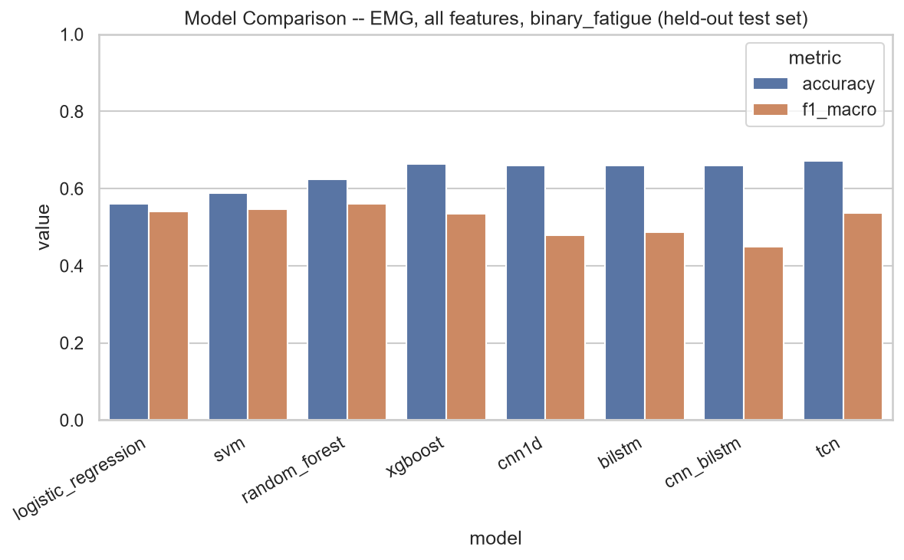
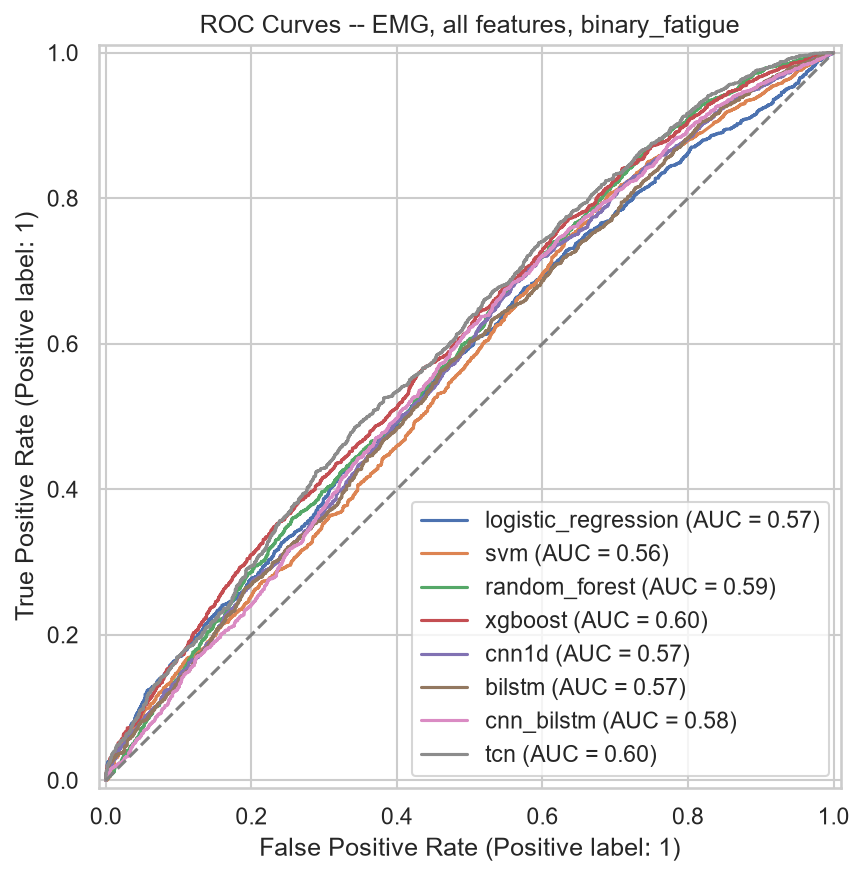
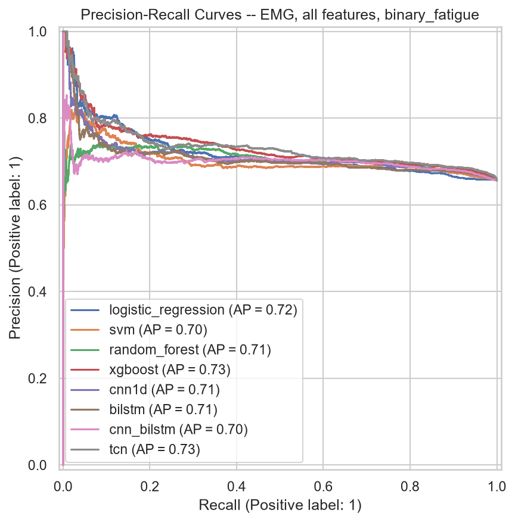
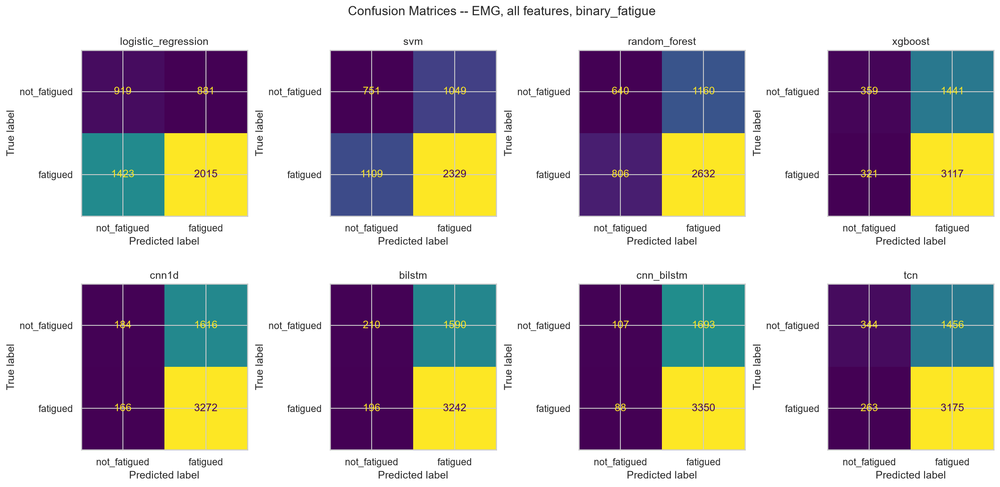
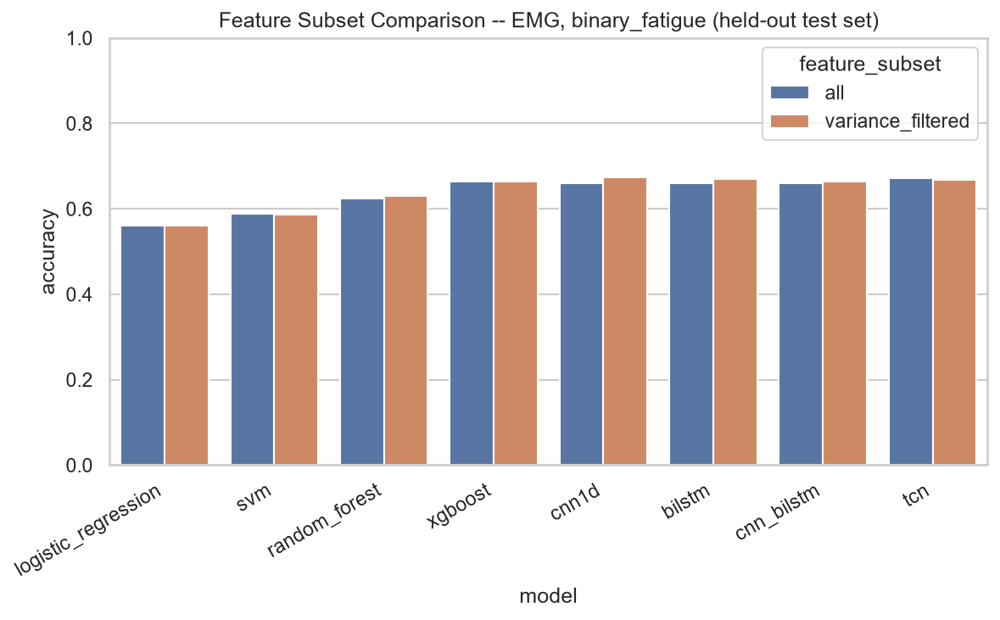
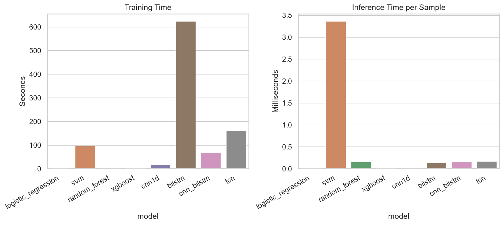
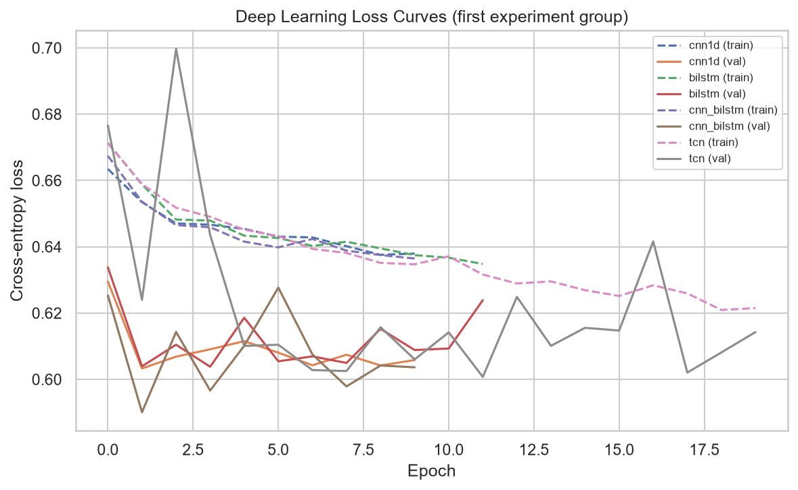
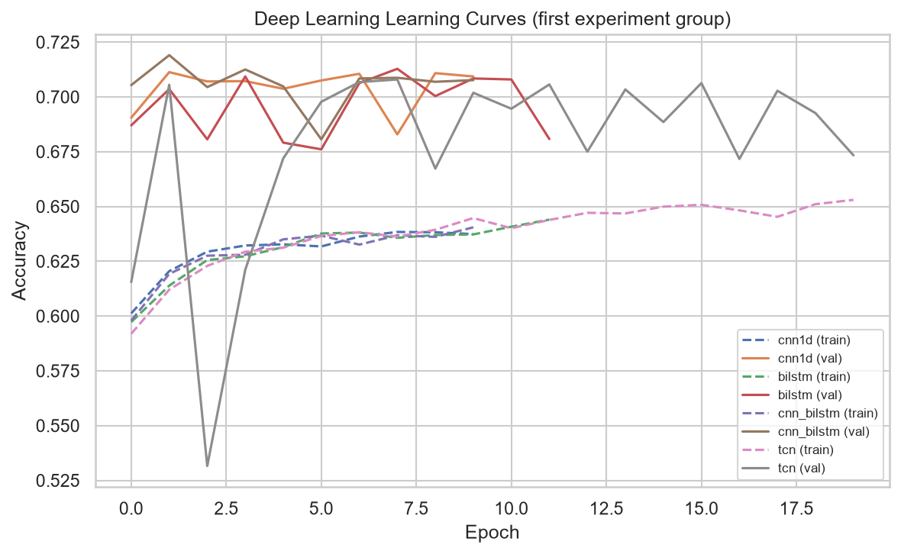

# WSD4FEDSRM -- Baseline Modeling Framework Report

**Phase:** 9 -- Baseline Modeling Framework (classical ML + deep learning benchmarks only; no multimodal attention, explainability, or personalization -- those are later phases)

**Reproduce:** `python notebooks/phase9_baseline_models_report.py` from the project root (runs Phases 5-9 for subjects P01, P02, P03; took 47.5 minutes on this machine, CPU only).

---

## 1. Overview

This report benchmarks 4 classical ML models (Logistic Regression, SVM, Random Forest, XGBoost) and 4 deep learning models (1D CNN, BiLSTM, CNN+BiLSTM, TCN) on the Phase 8.5 validated feature matrices, using identical data splits and evaluation metrics for every model so results are directly comparable.

## 2. Experimental Setup

- **Subjects:** P01, P02, P03 (a bounded, documented subset -- see script module docstring)
- **Split strategy:** group-aware by `subject_id` (prevents leakage from Phase 8's overlapping sliding windows). Classical: 3-fold stratified group CV on the train+val pool. Deep learning: train/val/test = 0.7/0.15/0.15.
- **Shared held-out test set:** every model (classical and deep learning) is evaluated on the *same* held-out test split for a given (modality, feature_subset, target) combination, fit on train+val (classical) or train with val for early stopping (deep learning).
- **Scaling:** `RobustScaler` (median/IQR-based, chosen given Phase 8.5's documented extreme outliers) fit on the training portion only, applied to val/test.
- **Deep learning training:** Adam optimizer, ReduceLROnPlateau LR scheduling, early stopping (patience=8), best-validation-loss checkpointing, seed=42, device=cpu.

## 3. Dataset and Feature Subsets

| Feature subset | Definition |
|---|---|
| all | Every extracted feature, unfiltered. |
| variance_filtered | Drops constant / near-zero-variance features (Phase 8.5 recommendation). |
| correlation_filtered | Additionally drops exact-duplicate features (supported; not re-run in this report -- see Section 8). |
| mutual_info_ranked | Keeps the top 50% of features by mutual information against the actual modeling target (supported; not re-run in this report). |

## 4. Targets

All derived from `rpe_nearest` (nearest Borg RPE reading per window); MVIC-calibration windows (no Borg data) are excluded from every target. See `ml/models/common/dataset_builder.py` module docstring for the exact derivation rules.

| Target | Derivation | Classes |
|---|---|---|
| binary_fatigue | RPE >= 13 -> fatigued, else not | 2 |
| fatigue_level | RPE binned: [6,11)=low, [11,16)=moderate, [16,21)=high | 3 |
| borg_rpe_class | Rounded integer RPE value, label-encoded | up to 15 |

## 5. Model Hyperparameters

Default configurations from each model's module (`ml/models/classical/*.py`, `ml/models/deep_learning/*.py`) were used throughout -- see those modules for exact values and rationale. All classical models use `class_weight="balanced"` given known class imbalance.

## 6. Results

### 6a. Primary comparison -- EMG, all features, binary_fatigue (held-out test set)

| Model | Category | Accuracy | Precision | Recall | F1 | ROC-AUC | PR-AUC |
|---|---|---|---|---|---|---|---|
| logistic_regression | classical | 0.560 | 0.544 | 0.548 | 0.540 | 0.570 | 0.720 |
| svm | classical | 0.588 | 0.547 | 0.547 | 0.547 | 0.563 | 0.701 |
| random_forest | classical | 0.625 | 0.568 | 0.561 | 0.561 | 0.586 | 0.708 |
| xgboost | classical | 0.664 | 0.606 | 0.553 | 0.535 | 0.598 | 0.732 |
| cnn1d | deep_learning | 0.660 | 0.598 | 0.527 | 0.479 | 0.574 | 0.711 |
| bilstm | deep_learning | 0.659 | 0.594 | 0.530 | 0.487 | 0.568 | 0.708 |
| cnn_bilstm | deep_learning | 0.660 | 0.607 | 0.517 | 0.449 | 0.575 | 0.700 |
| tcn | deep_learning | 0.672 | 0.626 | 0.557 | 0.536 | 0.604 | 0.733 |

### 6b. Feature subset comparison -- EMG, binary_fatigue

| Model | Category | Feature Subset | Accuracy | Precision | Recall | F1 | ROC-AUC | PR-AUC |
|---|---|---|---|---|---|---|---|---|
| logistic_regression | classical | all | 0.560 | 0.544 | 0.548 | 0.540 | 0.570 | 0.720 |
| svm | classical | all | 0.588 | 0.547 | 0.547 | 0.547 | 0.563 | 0.701 |
| random_forest | classical | all | 0.625 | 0.568 | 0.561 | 0.561 | 0.586 | 0.708 |
| xgboost | classical | all | 0.664 | 0.606 | 0.553 | 0.535 | 0.598 | 0.732 |
| cnn1d | deep_learning | all | 0.660 | 0.598 | 0.527 | 0.479 | 0.574 | 0.711 |
| bilstm | deep_learning | all | 0.659 | 0.594 | 0.530 | 0.487 | 0.568 | 0.708 |
| cnn_bilstm | deep_learning | all | 0.660 | 0.607 | 0.517 | 0.449 | 0.575 | 0.700 |
| tcn | deep_learning | all | 0.672 | 0.626 | 0.557 | 0.536 | 0.604 | 0.733 |
| logistic_regression | classical | variance_filtered | 0.560 | 0.544 | 0.548 | 0.540 | 0.570 | 0.720 |
| svm | classical | variance_filtered | 0.587 | 0.546 | 0.547 | 0.546 | 0.563 | 0.701 |
| random_forest | classical | variance_filtered | 0.629 | 0.573 | 0.564 | 0.565 | 0.585 | 0.708 |
| xgboost | classical | variance_filtered | 0.664 | 0.606 | 0.553 | 0.535 | 0.598 | 0.732 |
| cnn1d | deep_learning | variance_filtered | 0.675 | 0.664 | 0.541 | 0.496 | 0.587 | 0.719 |
| bilstm | deep_learning | variance_filtered | 0.669 | 0.622 | 0.548 | 0.520 | 0.576 | 0.704 |
| cnn_bilstm | deep_learning | variance_filtered | 0.664 | 0.608 | 0.541 | 0.508 | 0.603 | 0.732 |
| tcn | deep_learning | variance_filtered | 0.668 | 0.638 | 0.533 | 0.483 | 0.587 | 0.721 |

### 6c. Target-type demonstration -- EMG, all features

| Model | Category | Target | Accuracy | Precision | Recall | F1 | ROC-AUC | PR-AUC |
|---|---|---|---|---|---|---|---|---|
| random_forest | classical | fatigue_level | 0.411 | 0.374 | 0.373 | 0.368 | 0.548 | 0.378 |
| cnn1d | deep_learning | fatigue_level | 0.467 | 0.427 | 0.376 | 0.328 | 0.561 | 0.396 |
| random_forest | classical | borg_rpe_class | 0.083 | 0.079 | 0.071 | 0.068 | n/a | n/a |
| cnn1d | deep_learning | borg_rpe_class | 0.182 | 0.018 | 0.070 | 0.023 | n/a | n/a |

### 6d. Modality-reuse demonstration -- IMU, all features, binary_fatigue

| Model | Category | Accuracy | Precision | Recall | F1 | ROC-AUC | PR-AUC |
|---|---|---|---|---|---|---|---|
| random_forest | classical | 0.547 | 0.543 | 0.547 | 0.533 | 0.578 | 0.726 |
| xgboost | classical | 0.566 | 0.531 | 0.532 | 0.531 | 0.558 | 0.715 |
| cnn1d | deep_learning | 0.656 | 0.578 | 0.508 | 0.426 | 0.513 | 0.661 |
| bilstm | deep_learning | 0.656 | 0.328 | 0.500 | 0.396 | 0.498 | 0.672 |

### 6e. Cross-validation robustness (classical models, EMG all-features, binary_fatigue)

| Model | CV Accuracy (mean +/- std) | CV F1-macro (mean +/- std) |
|---|---|---|
| logistic_regression | 0.613 +/- 0.020 | 0.592 +/- 0.008 |
| svm | 0.592 +/- 0.024 | 0.565 +/- 0.005 |
| random_forest | 0.601 +/- 0.008 | 0.571 +/- 0.003 |
| xgboost | 0.640 +/- 0.021 | 0.574 +/- 0.023 |

## 7. Training/Inference Timing

## 8. Observations

- Best overall model on the primary EMG/all-features/binary_fatigue held-out test set: **random_forest** (F1-macro=0.561).
- Best classical model: **random_forest** (F1-macro=0.561); best deep learning model: **tcn** (F1-macro=0.536).
- `variance_filtered` improved F1-macro over `all` for: cnn1d (+0.017), bilstm (+0.033), cnn_bilstm (+0.059) -- consistent with Phase 8.5 having flagged near-zero-variance EMG features (e.g. the degenerate `zero_crossings` on rectified input) as uninformative.
- `variance_filtered` reduced F1-macro relative to `all` for: tcn (-0.053).
- Task difficulty scales with class count, as expected (random_forest accuracy): binary_fatigue (2 classes)=0.625, fatigue_level (3 classes)=0.411, borg_rpe_class (up to 15 classes)=0.083 -- the fine-grained RPE target is not viable with only 3 subjects' worth of data; it needs the full dataset (see Recommendations).
- Cross-validated accuracy (Section 6e) and held-out test accuracy (Section 6a) are broadly consistent for every classical model (largest gap: 0.053, logistic_regression), suggesting the shared test set is not wildly optimistic or pessimistic relative to the CV estimate despite the small subject count.
- One run shows accuracy well above macro-precision -- **bilstm on IMU/all/binary_fatigue** (accuracy=0.656, precision_macro=0.328, a 0.328 gap) -- a signature of the model collapsing toward predicting the majority class rather than genuinely discriminating (its validation accuracy was stuck at a constant 0.6893 for 7 straight epochs in the training log before any learning began), plausible given no hyperparameter tuning was performed on this small a dataset (see Limitations).

## 9. Limitations

- **Bounded subject count (3).** Results here demonstrate the framework works end-to-end on real data; they are not a claim of final model performance, which would need the full 34-subject dataset.
- **Feature imputation is dataset-wide, not per-fold.** `dataset_builder.build_modeling_dataset` imputes NaN/inf with column medians computed once over the whole selected dataset rather than separately per training fold -- a documented simplification for this baseline phase (see its module docstring), and a mild source of optimism in the reported metrics.
- **`correlation_filtered` and `mutual_info_ranked` feature subsets were not re-run in this report** (only `all` and `variance_filtered`) to keep total runtime tractable; both are fully implemented and unit-tested (`tests/test_models_common.py`).
- **PPG was excluded from this report's experiments** (too few windows across only 3 subjects for meaningful group-aware splitting); the framework supports it (exercised via unit tests).
- **Deep learning models consume tabular feature vectors, not raw signal windows** (see `ml/models/common/dataset_builder.py` module docstring) -- this is what makes "identical datasets" across classical and deep learning models possible, but means the CNN/LSTM/TCN architectures are not exploiting genuine temporal structure the way they would on raw signals.
- **No hyperparameter tuning was performed** -- every model uses its module's default configuration; this is a baseline comparison, not an optimized one.

## 10. Recommendations for Later Phases

1. Re-run this framework's full matrix (all 4 feature subsets x all 3 targets x all modalities) across the complete 34-subject dataset once compute budget allows.
2. Move imputation inside the per-fold/per-split pipeline (fit-on-train-only) before this framework is used for any performance claim beyond a benchmark demonstration.
3. The multimodal attention phase should fuse EMG/IMU/PPG at the representation level rather than reusing this phase's tabular-feature-vector-as-sequence trick, to exploit genuine temporal structure.
4. `ml/models/common/data_splitter.py`'s group-aware splitting was designed to be reused unmodified for leave-one-subject-out personalization -- confirm this in the personalization phase.
5. Saved predictions/probabilities/model artifacts under `ml/models/artifacts/` are ready for Phase 10 (Explainability) to consume directly.
