# WSD4FEDSRM -- Exploratory Data Analysis Report

**Phase:** 6 -- Exploratory Data Analysis (analysis only; no preprocessing, normalization, filtering, feature engineering, or modeling)

**Reproduce:** `python notebooks/phase6_eda_analysis.py` from the project root (loads the dataset via `ml.preprocessing.dataset_loader.WSD4FEDSRMLoader`, ~70-90s).

---

## 1. Dataset Overview

- **Subjects loaded:** 34
- **Distinct experimental conditions:** 10 (6 fatigue tasks + 4 MVIC calibration trials)
- **Total subject-condition recordings:** 340 (expected 340)
- **Total individual sensor recordings:** 4284 (EMG=2040, IMU=2040, PPG=204)
- **Sensor modalities available:** EMG, IMU, PPG (PPG only for fatigue-task conditions)

## 2. Signal Statistics

| Modality | Recordings | Sampling rate (Hz) | Duration (s) | Samples per recording |
|---|---|---|---|---|
| EMG | 2040 | 1000 | mean=47.98, std=40.69, min=5.27, max=251.93 | mean=47978.06, std=40691.66, min=5270.00, max=251930.00 |
| IMU | 2040 | 100 | mean=47.97, std=40.67, min=5.27, max=251.93 | mean=4797.27, std=4067.46, min=527.00, max=25193.00 |
| PPG | 204 | 200 | mean=72.50, std=35.45, min=19.86, max=251.93 | mean=14500.01, std=7090.06, min=3972.00, max=50386.00 |

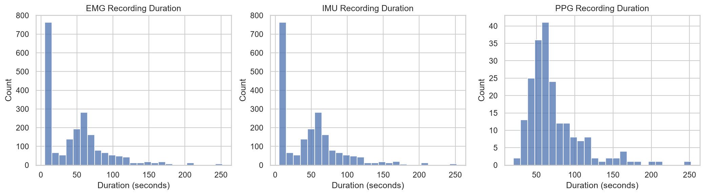

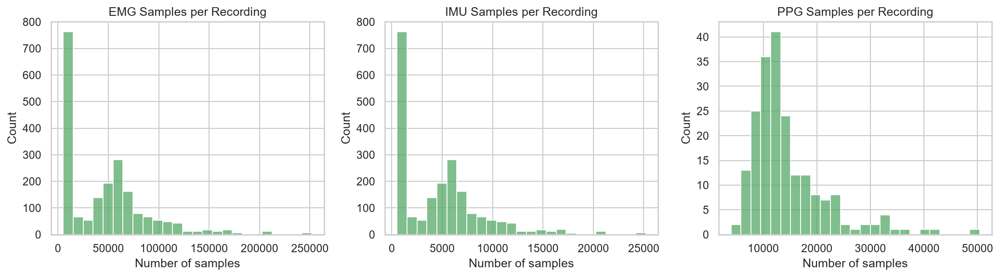

Recording durations vary *within* each modality because the fatigue protocol runs each trial until the participant reaches Borg RPE = 20 (volitional exhaustion) or the intensity-specific cutoff -- trial length is itself fatigue-related signal, not measurement noise.

## 3. Missing Data Analysis

- **Missing files/sensors during load:** 0 across all 34 subjects and 10 conditions (the Phase 5 loader logs a warning for every missing file/sensor; none were logged for this dataset).
- **Subjects with incomplete records:** 0 / 34 (none)
- **Missing values within raw sensor signals (NaN cells):**
  - EMG: 0 / 97875240 cells (0.0000%)
  - IMU: 0 / 88077834 cells (0.0000%)
  - PPG: 0 / 2958002 cells (0.0000%)
- **Structurally absent modalities (by design, not data loss):** PPG and Borg `Labels` are `None` for all 4 MVIC calibration conditions per subject -- confirmed against the source dataset (PPG was never recorded during MVIC trials; `borg_data.csv` contains exactly 34x6=204 rows, none for MVIC).
- **Borg RPE timeseries sparsity:** each fatigue trial has up to 25 scheduled RPE readings (before-task + every 10s to 250s), but trials end at exhaustion, so most trials have far fewer. Observed: mean=6.43, std=3.59, min=1.00, max=24.00 readings per trial out of a possible 25.

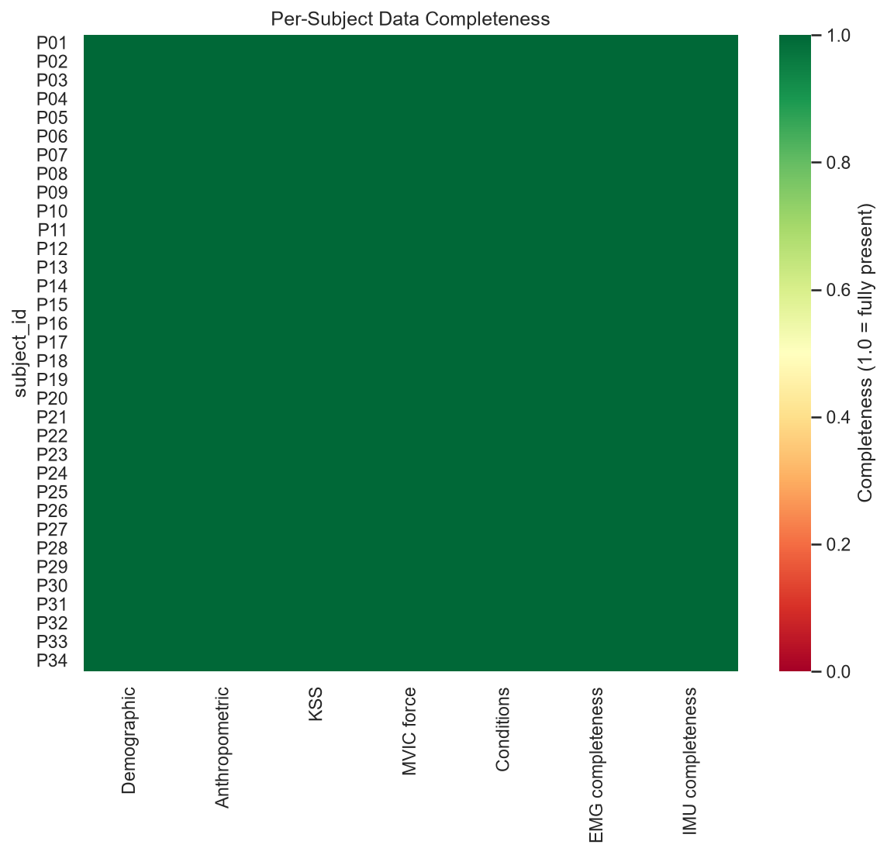

## 4. Label Analysis

- **Borg RPE before task:** mean=6.03, std=0.17, min=6.00, max=7.00
- **Borg RPE at end of trial:** mean=20.00, std=0.00, min=20.00, max=20.00
- **All individual RPE readings (n=1311):** mean=14.53, std=3.66, min=6.00, max=19.00
- **Trial duration until exhaustion (s):** mean=71.58, std=35.69, min=18.00, max=250.00
- **KSS before session:** mean=3.97, std=1.66, min=1.00, max=7.00
- **KSS after session:** mean=4.53, std=1.56, min=1.00, max=7.00
- **MVIC mean force, internal rotation (N):** mean=89.28, std=27.32, min=50.00, max=175.00
- **MVIC mean force, external rotation (N):** mean=77.29, std=20.38, min=35.00, max=117.50

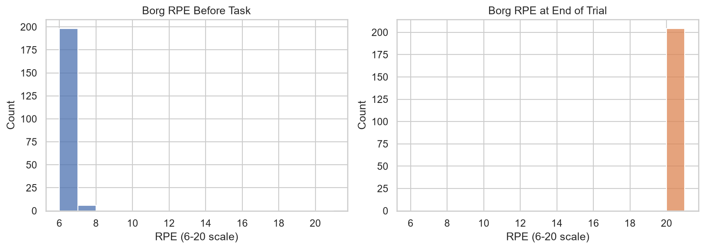

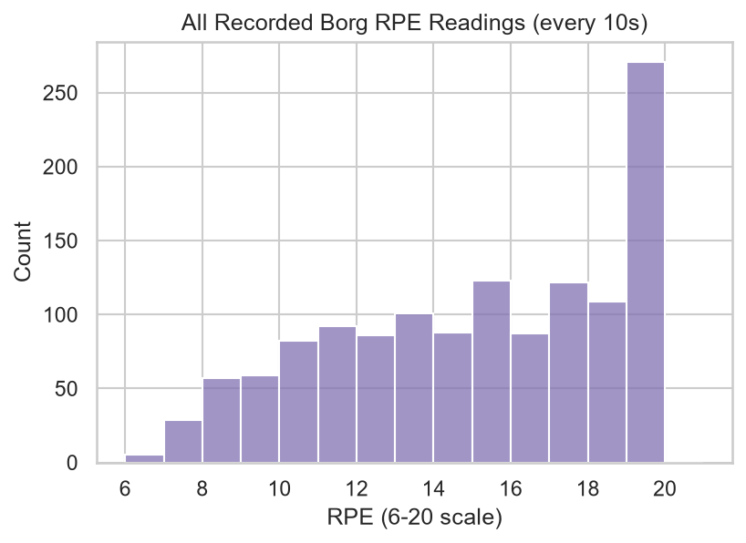

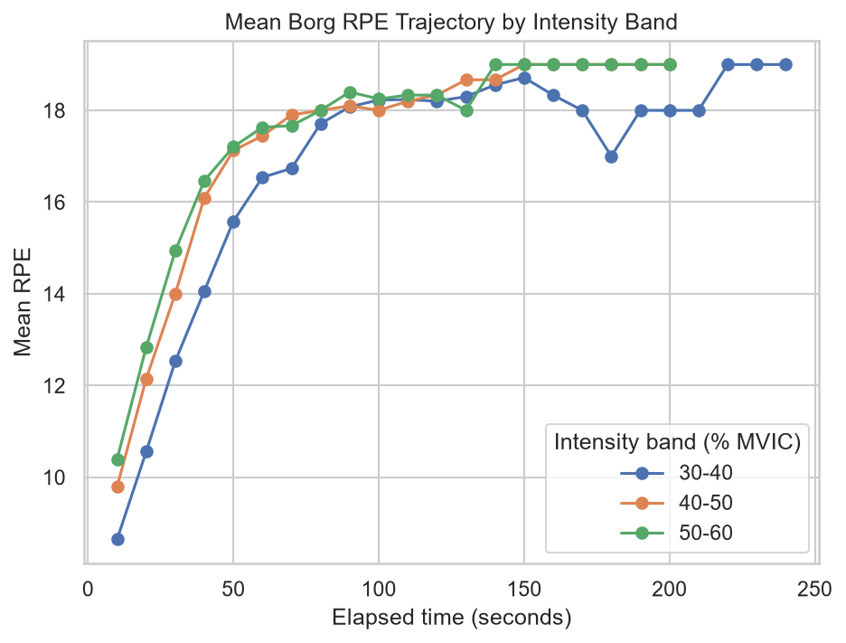

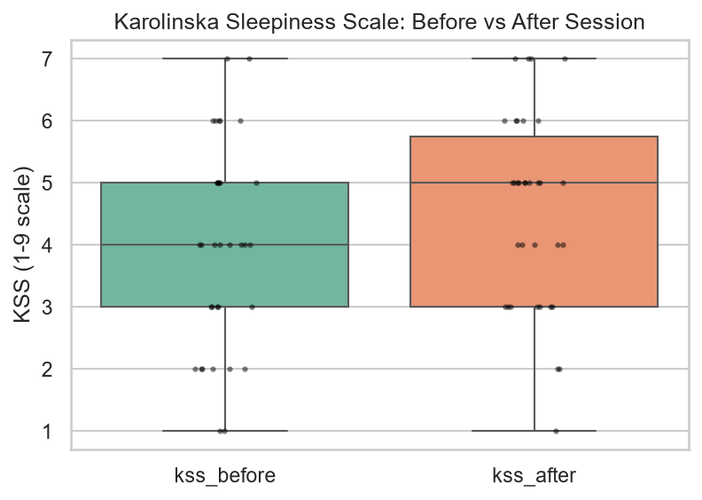

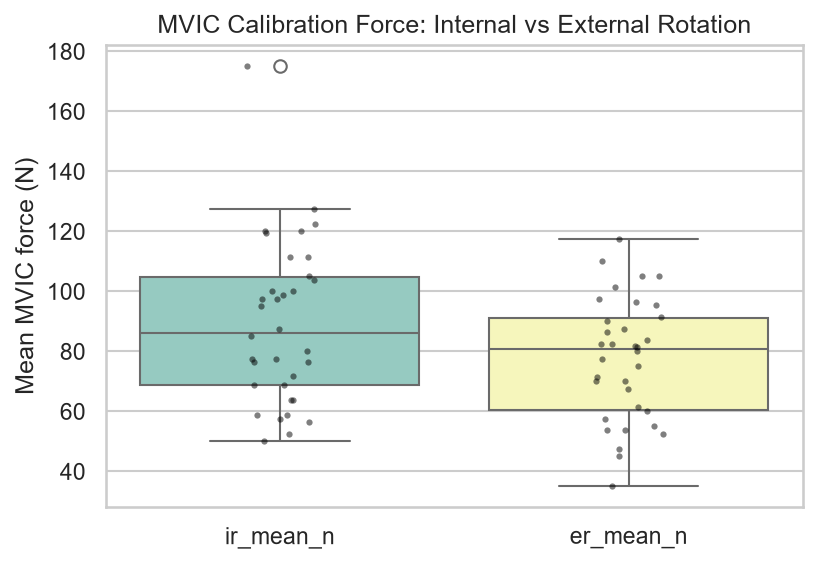

## 5. Participant Statistics

- **Age (years):** mean=26.35, std=3.98, min=20.00, max=35.00
- **Height (cm):** mean=174.97, std=9.97, min=155.00, max=195.00
- **Weight / mass (kg):** mean=74.38, std=18.52, min=45.30, max=133.00
- **BMI:** mean=23.99, std=3.88, min=18.20, max=35.00
- **Sex:** {'male': 23, 'female': 11}
- **Dominant hand:** {'right': 32, 'left': 2}

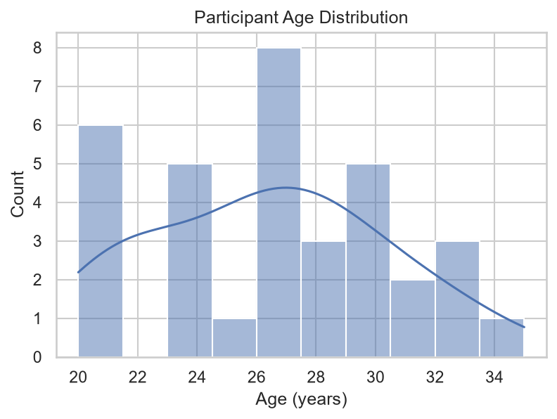

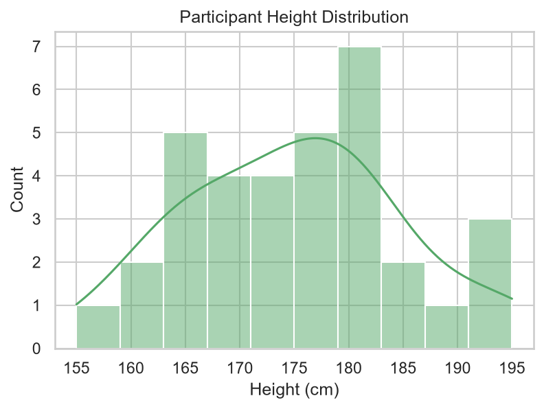

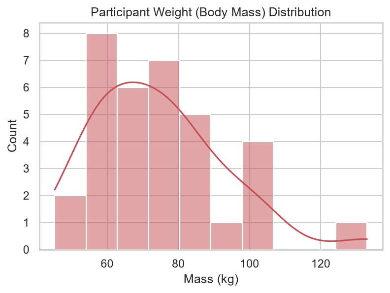

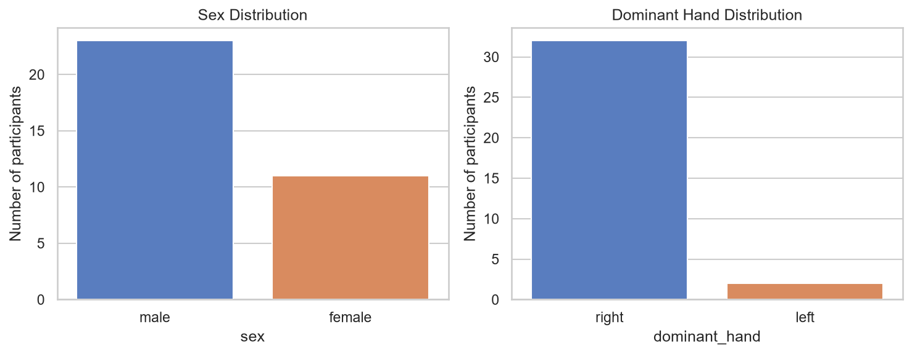

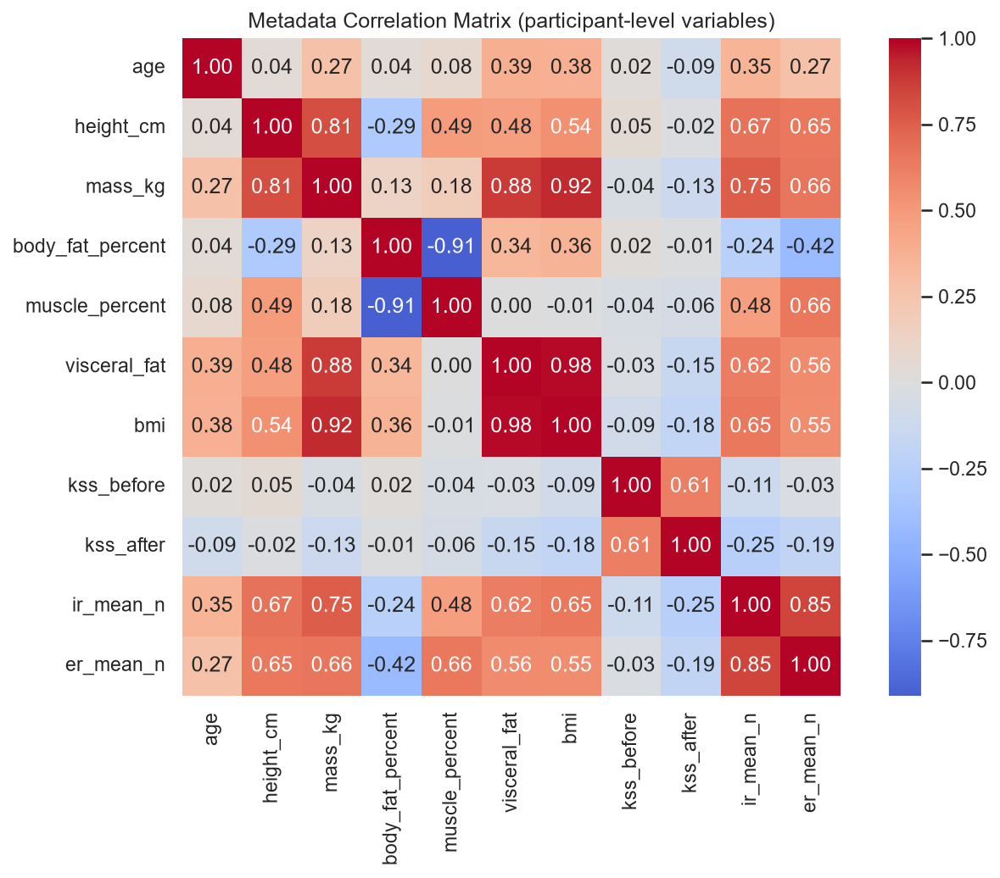

## 6. Condition Analysis

- **Internal vs external rotation trials:** {'external_rotation': 170, 'internal_rotation': 170}
- **Fatigue-task vs MVIC-calibration trials:** {'fatigue_task': 204, 'mvic_calibration': 136}
- **Subjects per condition:** every one of the 10 conditions has recordings from 34-34 subjects (out of 34).

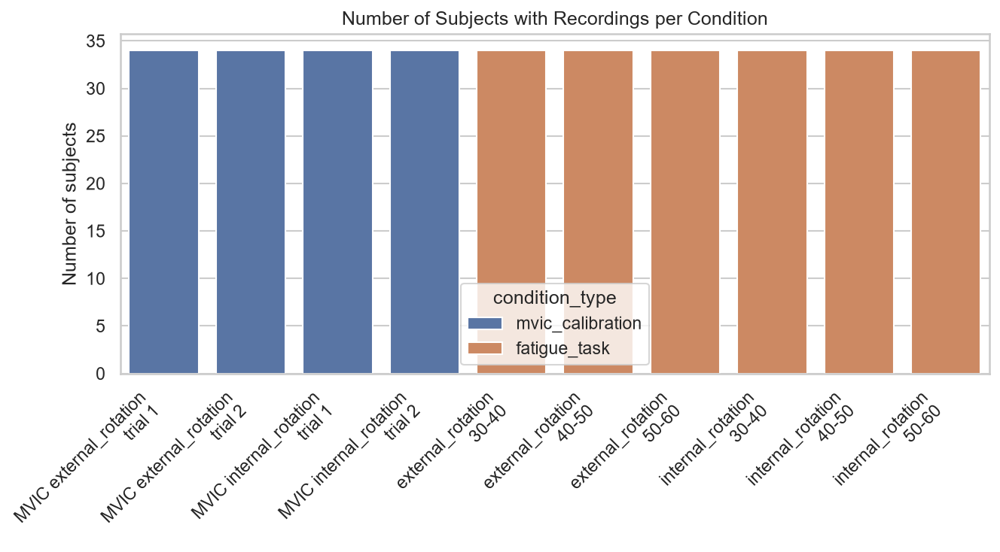

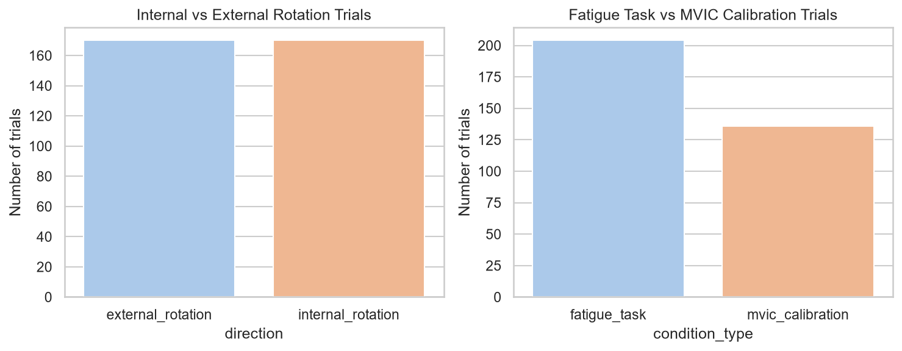

## 7. Key Observations

- The dataset is essentially **complete**: 0 missing files/sensors were logged by the loader across all 34 subjects x 10 conditions, and only 0 subject(s) have any incomplete subject-level record.
- Trial **duration is highly variable by design** -- it directly encodes time-to-exhaustion, the core fatigue signal, rather than being a nuisance to normalize away without care.
- Borg RPE readings are **sparse by construction** (trials end early at exhaustion), so any tabular/matrix representation of the RPE timeseries will have structural missingness that must be handled explicitly (not imputed as if it were random).
- PPG and Labels are **legitimately absent for all MVIC conditions** -- any multimodal fusion design must treat this as an expected, structural branch (MVIC vs. fatigue-task) rather than a data quality defect.
- Anthropometric source files (breadth/circumference/depth/length) contain typos in column names (e.g. "ditsal" for "distal") -- these were intentionally preserved verbatim by the Phase 5 loader and are visible here as-is.

## 8. Potential Preprocessing Challenges

- **Variable-length signals:** EMG/IMU/PPG recordings differ in sample count per trial (see Section 2); downstream models will need windowing/padding/resampling strategies rather than assuming fixed-length input.
- **Sparse, irregularly-terminated RPE labels:** converting `rpe_timeseries` into a regression/classification target requires an explicit policy for censored/early-terminated trials (e.g. last-observation-carried-forward vs. survival-style modeling of time-to-RPE-20).
- **Multi-rate fusion:** EMG (1000 Hz), IMU (100 Hz), and PPG (200 Hz) must be aligned/resampled consistently before any multimodal fusion model can consume them jointly.
- **Structural modality absence in MVIC trials:** any shared preprocessing pipeline must branch on condition type rather than assuming all 3 modalities are always present.
- **Messy anthropometric column names:** the loader preserves raw (typo'd, inconsistently formatted) column names verbatim in `breadth_cm`/`circumference_cm`/`depth_cm`/`length_cm`; a preprocessing step should map these onto clean, stable feature names before they reach any model.

## 9. Data Quality Issues

- No subjects with incomplete subject-level metadata were found.
- Raw sensor CSVs (EMG/IMU/PPG) contain effectively no missing values within-file (see Section 3 percentages).
- Source metadata files (demographic.csv, MVIC_force_data.csv, anthropometric files) use inconsistent column naming/spacing across files; the loader's tolerant column-matching handled this without data loss, but any external tool consuming the raw CSVs directly would need the same tolerance.

## 10. Recommendations for Phase 7 (Preprocessing)

1. Define an explicit windowing/resampling strategy per modality before any fusion (EMG 1000 Hz, IMU 100 Hz, PPG 200 Hz).
2. Decide and document a single policy for handling early-terminated Borg RPE trajectories (e.g. treat `trial_duration_seconds` / time-to-RPE-20 as the primary regression target, rather than padding the sparse timeseries).
3. Keep MVIC-calibration and fatigue-task trials in separate preprocessing branches given their structurally different modality availability (no PPG/labels for MVIC).
4. Rename/standardize the anthropometric measurement keys (breadth/circumference/depth/length) to clean, typo-free feature names as an explicit, documented mapping step -- do not silently guess at intent.
5. Use subject-level MVIC force (ir_mean_n/er_mean_n) to normalize task load (%MVIC) if constructing cross-subject-comparable load features.
6. Retain raw data untouched (as now) and produce all cleaned/resampled artifacts under `datasets/processed/`, consistent with the project's existing raw/processed separation.
