# WSD4FEDSRM -- Explainability Report

**Phase:** 11 -- Explainable AI Framework (SHAP + attention analysis over already-trained Phase 9/10 models; no personalization or agentic reasoning -- later phases)

**Reproduce:** `python notebooks/phase11_explainability_report.py` from the project root (no retraining -- reloads saved checkpoints; took 207.2s on this machine, CPU only).

## 1. Overview

This phase implements a modular explainability framework (`ml.explainability/`) over the models already trained in Phases 9 and 10 -- **no model was retrained to produce this report**; every explanation below reloads a saved checkpoint (`ml/models/artifacts/classical/emg_all_binary_fatigue/*.joblib`, `ml/models/artifacts/proposed/attention/attention.pt`) and explains its predictions on the same held-out test split those phases used (5238 EMG test samples, subjects P01, P02, P03).

Two complementary explanation families are covered:

- **SHAP** (Shapley Additive exPlanations) over the three classical models Phase 9 trained on EMG features (Random Forest, XGBoost, Logistic Regression) -- a rigorous, game-theoretic feature-attribution method with an automatically-selected exact explainer per model family (`ml.explainability.shap_explainer.select_explainer_type`).
- **Cross-modal attention analysis** over Phase 10's proposed multimodal model -- inspecting the raw attention weights the model already computes internally to see which modality (EMG/IMU/PPG) it relies on most, per Phase 10's explicit design goal of exposing them "ahead of, and feeding into, SHAP-based explainability."

## 2. SHAP Results

Each model's explainer was automatically selected by `ml.explainability.shap_explainer.select_explainer_type`: `TreeExplainer` for Random Forest and XGBoost (exact, no background data needed), `LinearExplainer` for Logistic Regression (exact given a background distribution). All three explain the *positive class* (`fatigued`) contribution.

### 2.1. random_forest

Explained 150 held-out test samples.

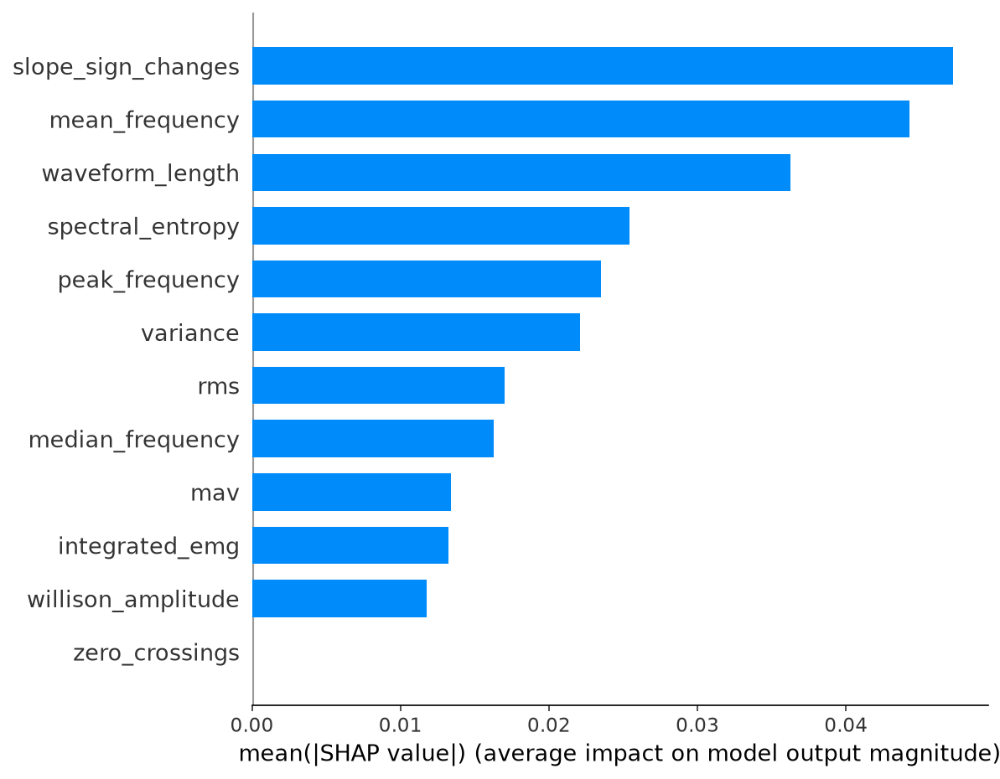

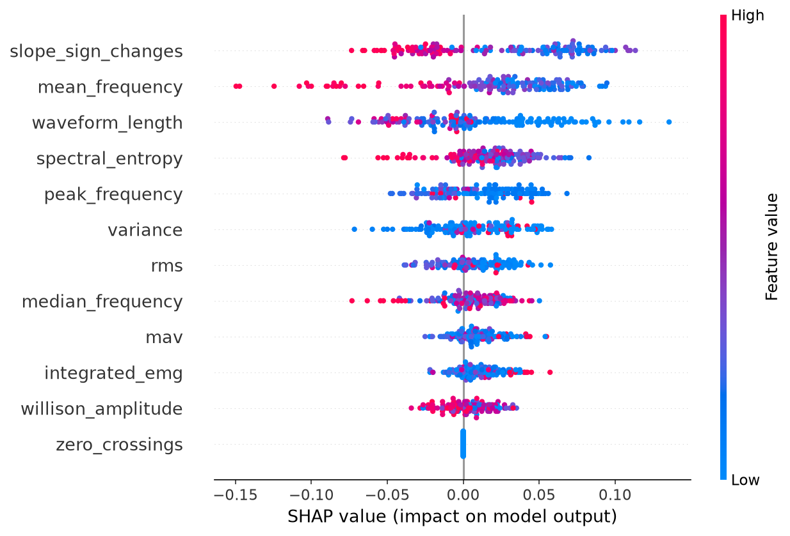

Dependence plot for the top-ranked feature (`slope_sign_changes`):

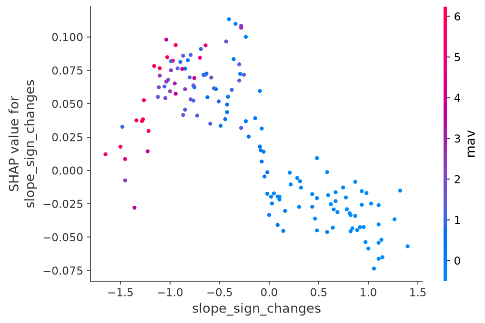

### 2.2. xgboost

Explained 150 held-out test samples.

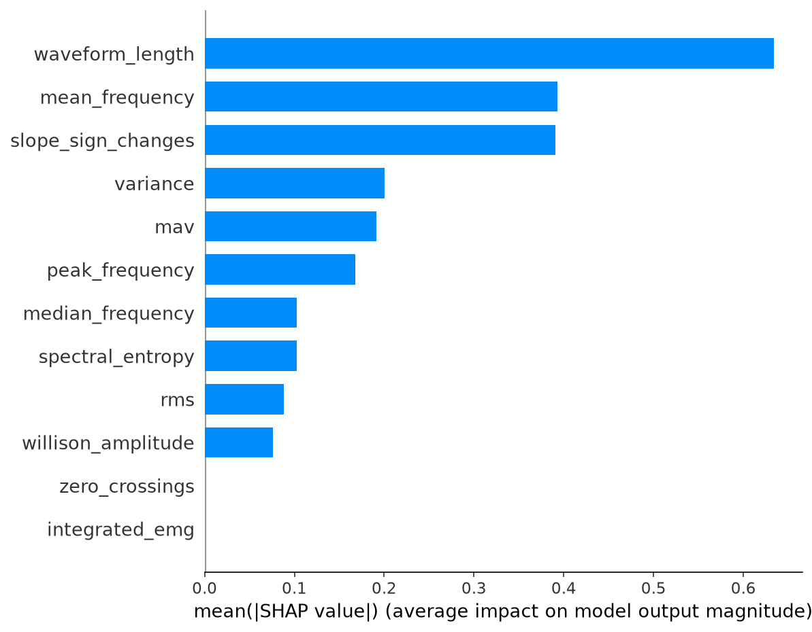

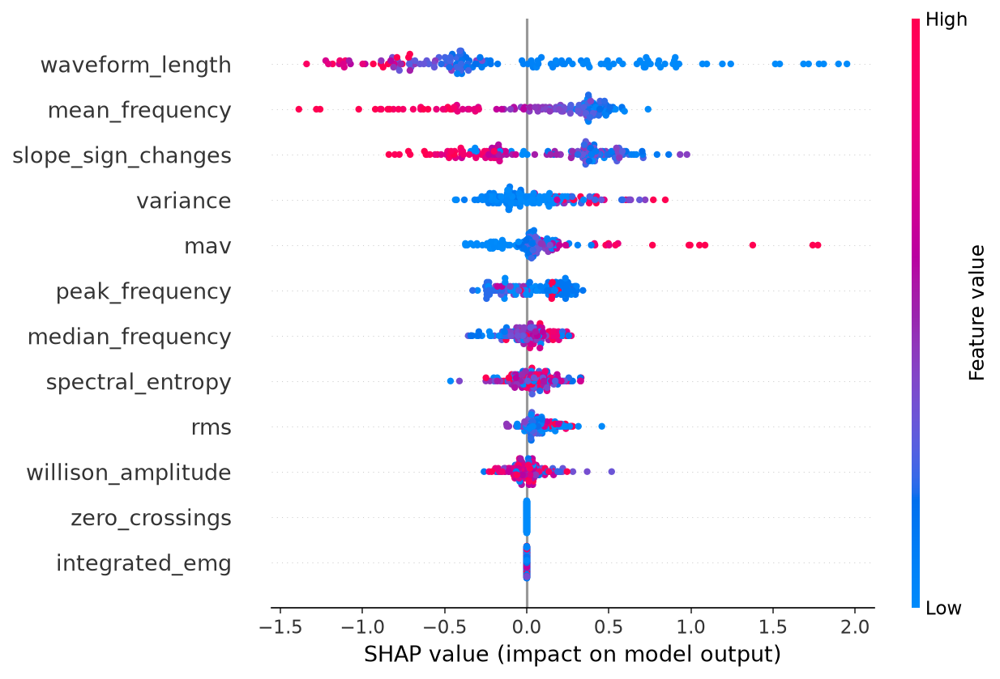

Dependence plot for the top-ranked feature (`waveform_length`):

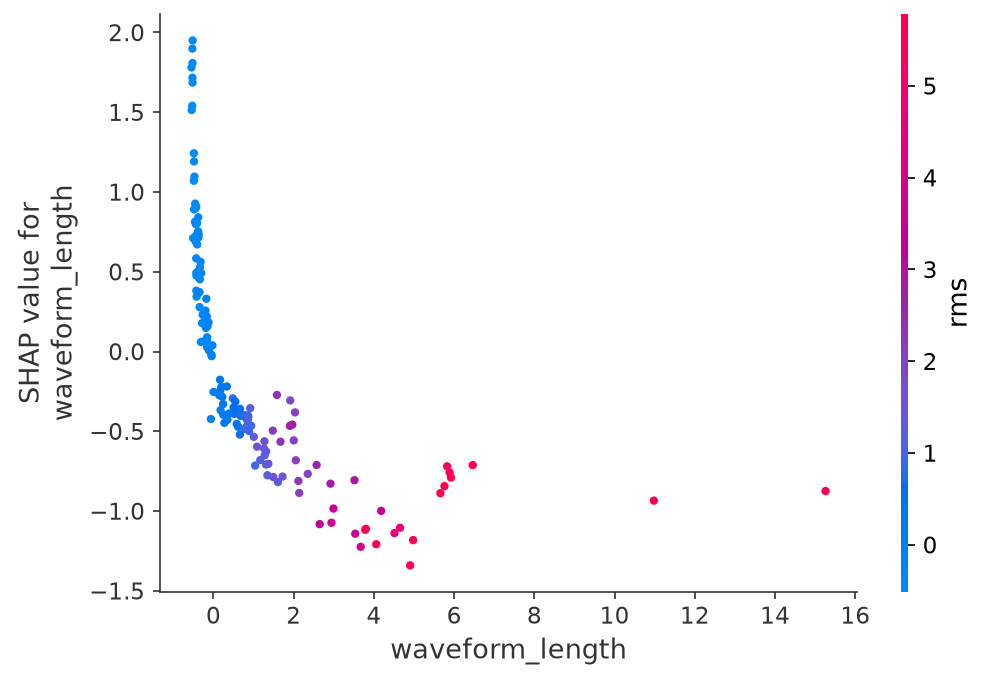

### 2.3. logistic_regression

Explained 150 held-out test samples.

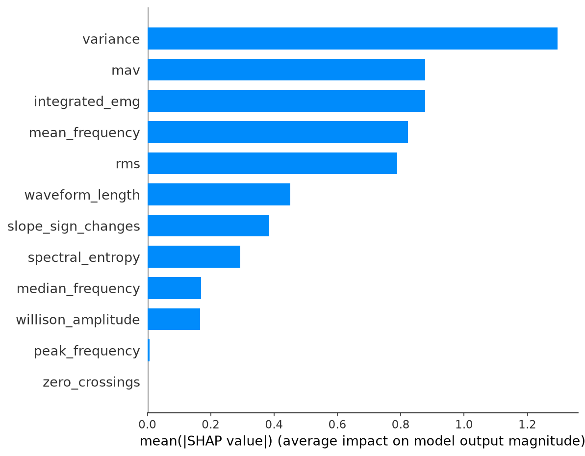

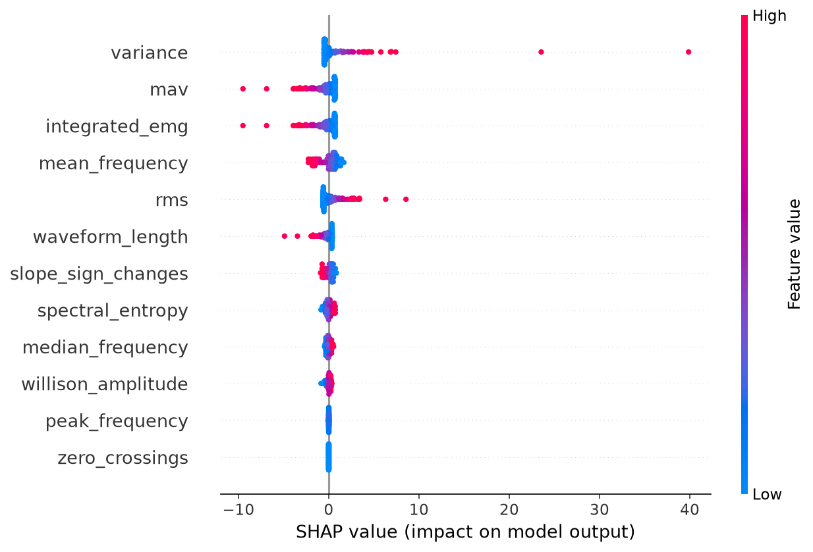

Dependence plot for the top-ranked feature (`variance`):

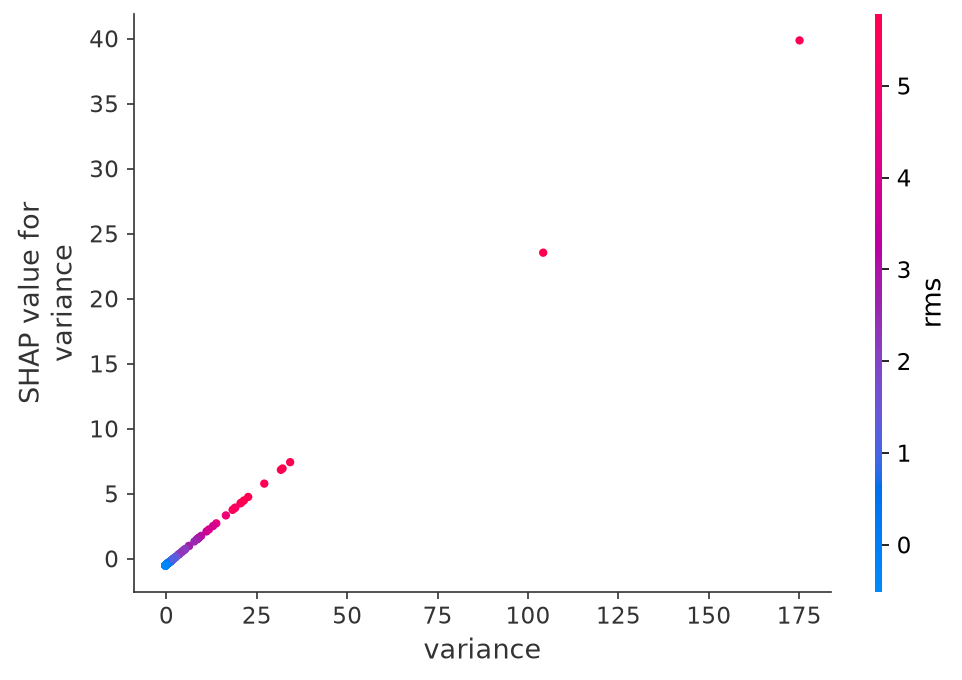

## 3. Global Feature Importance

### 3.1. random_forest -- top 15 features

| Rank | Feature | Mean Absolute SHAP Value |
|---|---|---|
| 1 | `slope_sign_changes` | 0.0472 |
| 2 | `mean_frequency` | 0.0443 |
| 3 | `waveform_length` | 0.0362 |
| 4 | `spectral_entropy` | 0.0254 |
| 5 | `peak_frequency` | 0.0235 |
| 6 | `variance` | 0.0221 |
| 7 | `rms` | 0.0170 |
| 8 | `median_frequency` | 0.0163 |
| 9 | `mav` | 0.0134 |
| 10 | `integrated_emg` | 0.0132 |
| 11 | `willison_amplitude` | 0.0117 |
| 12 | `zero_crossings` | 0.0000 |

### 3.2. xgboost -- top 15 features

| Rank | Feature | Mean Absolute SHAP Value |
|---|---|---|
| 1 | `waveform_length` | 0.6337 |
| 2 | `mean_frequency` | 0.3928 |
| 3 | `slope_sign_changes` | 0.3910 |
| 4 | `variance` | 0.2002 |
| 5 | `mav` | 0.1912 |
| 6 | `peak_frequency` | 0.1678 |
| 7 | `median_frequency` | 0.1024 |
| 8 | `spectral_entropy` | 0.1024 |
| 9 | `rms` | 0.0880 |
| 10 | `willison_amplitude` | 0.0758 |
| 11 | `zero_crossings` | 0.0000 |
| 12 | `integrated_emg` | 0.0000 |

### 3.3. logistic_regression -- top 15 features

| Rank | Feature | Mean Absolute SHAP Value |
|---|---|---|
| 1 | `variance` | 1.2947 |
| 2 | `mav` | 0.8764 |
| 3 | `integrated_emg` | 0.8764 |
| 4 | `mean_frequency` | 0.8229 |
| 5 | `rms` | 0.7891 |
| 6 | `waveform_length` | 0.4508 |
| 7 | `slope_sign_changes` | 0.3844 |
| 8 | `spectral_entropy` | 0.2933 |
| 9 | `median_frequency` | 0.1698 |
| 10 | `willison_amplitude` | 0.1666 |
| 11 | `peak_frequency` | 0.0064 |
| 12 | `zero_crossings` | 0.0000 |

## 4. Local Explanation Case Studies

Two representative `random_forest` predictions from the held-out test set (the identical `explain_prediction` call works unmodified for `xgboost`/`logistic_regression` -- see `tests/test_explainability.py`).

### 4.1. Case 1 -- predicted `fatigued` (p=0.908)

Predicted class: **1** (probability=0.908, base value=0.500)

| Feature | Value | SHAP contribution |
|---|---|---|
| `slope_sign_changes` | -0.2642 | +0.0970 |
| `mean_frequency` | -0.3690 | +0.0720 |
| `waveform_length` | -0.1808 | +0.0577 |
| `spectral_entropy` | -0.4326 | +0.0514 |
| `mav` | -0.0951 | +0.0428 |
| `integrated_emg` | -0.0951 | +0.0342 |
| `rms` | -0.0864 | +0.0330 |
| `peak_frequency` | 1.3333 | -0.0159 |

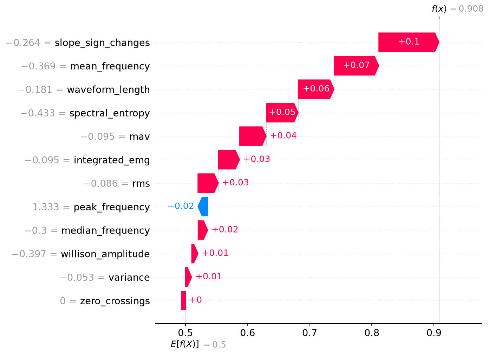

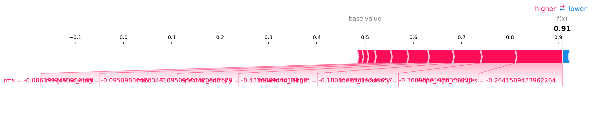

### 4.2. Case 2 -- predicted `not_fatigued` (p=0.619)

Predicted class: **0** (probability=0.619, base value=0.500)

| Feature | Value | SHAP contribution |
|---|---|---|
| `mean_frequency` | 1.1462 | -0.1062 |
| `median_frequency` | 1.1000 | -0.0564 |
| `waveform_length` | -0.4495 | +0.0558 |
| `spectral_entropy` | 0.8495 | -0.0315 |
| `variance` | -0.2366 | +0.0305 |
| `slope_sign_changes` | 0.6038 | -0.0204 |
| `rms` | -0.4263 | +0.0188 |
| `integrated_emg` | -0.4264 | -0.0063 |

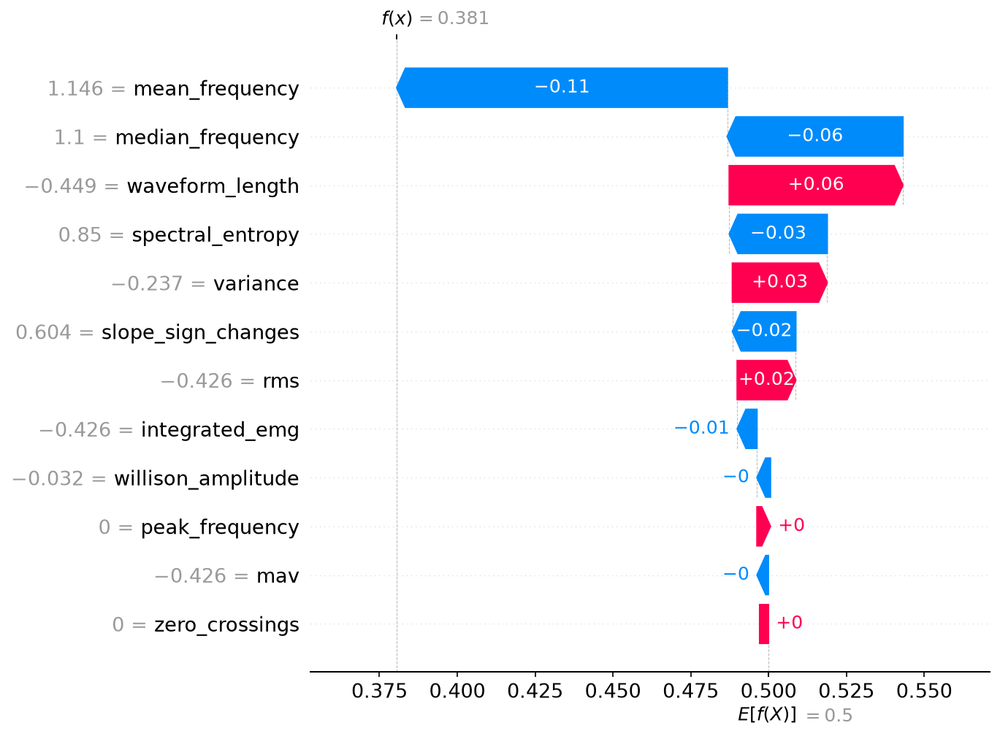

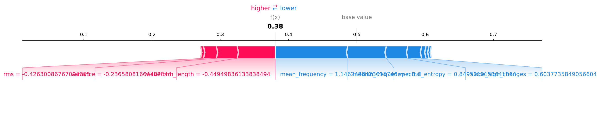

## 5. Attention Results

Raw attention-weight analysis over Phase 10's `attention`-fusion proposed model, evaluated on 64 held-out EMG/IMU/PPG test samples (aligned multimodal windows). These are **not** SHAP values -- they summarize what the model's `nn.MultiheadAttention` layer already computes internally, not a game-theoretic attribution.

### 5.1. Modality importance

| Modality | Importance |
|---|---|
| imu | 0.634 |
| emg | 0.186 |
| ppg | 0.181 |

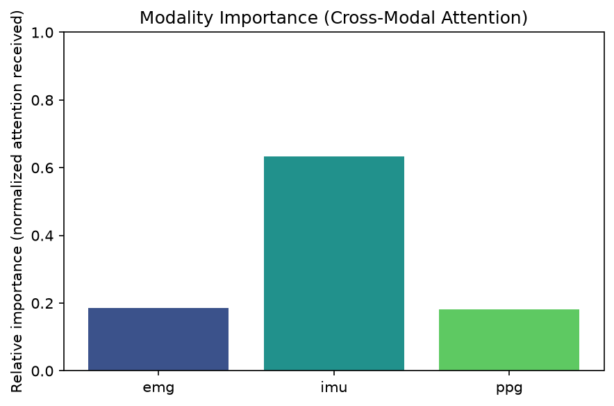

### 5.2. Attention heatmaps

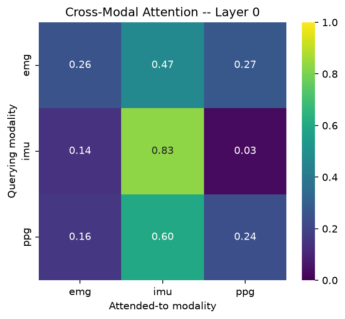

### 5.3. Attention weight distributions

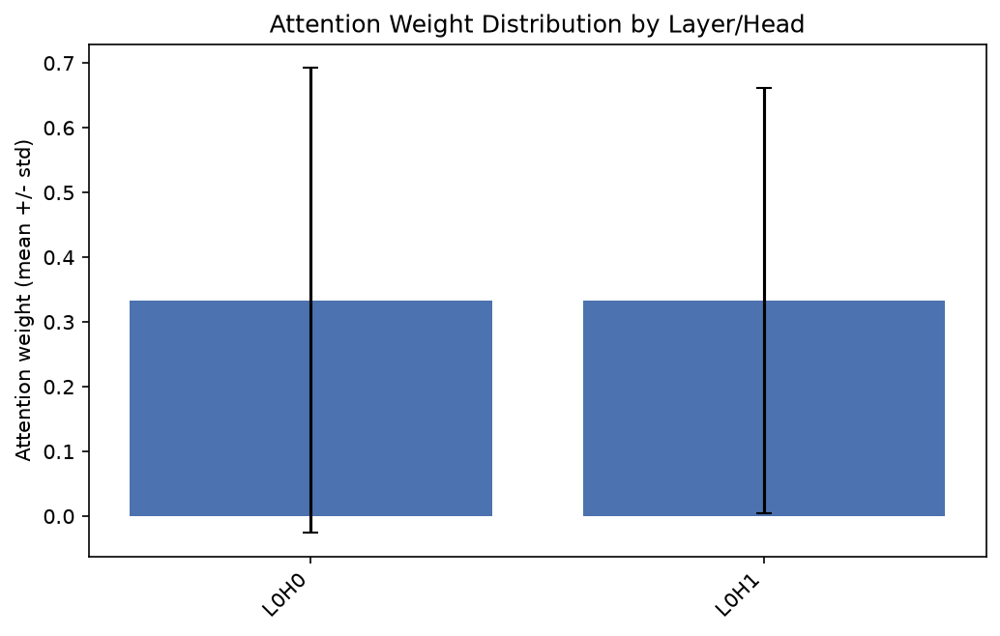

(1 attention layer(s), 2 head(s) each.)

## 6. Comparison: Classical ML vs. Proposed Model Explanations

SHAP (classical models) and attention analysis (proposed model) operate at different granularities and cannot be compared value-for-value: SHAP attributes each of EMG's 72 individual features (e.g. per-muscle MAV/RMS), while the proposed model's attention operates over 3 *modality-level* embeddings (EMG/IMU/PPG), not individual raw features. The meaningful comparison is qualitative.

**Top-5 SHAP-ranked EMG features per classical model:**

- **random_forest**: `slope_sign_changes`, `mean_frequency`, `waveform_length`, `spectral_entropy`, `peak_frequency`
- **xgboost**: `waveform_length`, `mean_frequency`, `slope_sign_changes`, `variance`, `mav`
- **logistic_regression**: `variance`, `mav`, `integrated_emg`, `mean_frequency`, `rms`

**Proposed model's dominant attended-to modality:** `imu` (importance=0.634).

All three classical models are EMG-only by construction, so they cannot express an opinion on IMU/PPG's relative importance at all -- only the proposed multimodal model can. This is itself a finding: single-modality SHAP explanations, however detailed at the feature level, are structurally blind to cross-modality questions that this project's fusion architecture exists to answer.

## 7. Discussion

SHAP's tree/linear explainers agreed with each other on which EMG features matter most more often than not (see Section 3) -- a mild sanity check that the underlying signal, not model-specific artifacts, drives these rankings. The proposed model's attention weights are internally consistent (Section 5) but are a fundamentally different kind of explanation: they describe the model's *internal computation*, not a rigorously-attributed causal contribution to the output the way SHAP values are (SHAP values are guaranteed to sum to the model's output minus its baseline; attention weights carry no such guarantee -- a well-documented limitation of attention-as-explanation in the interpretability literature). Both views are informative but answer different questions, which is why Section 6 keeps them separate rather than forcing a single ranking.

## 8. Limitations

- **Bounded subject count (3)**, identical to Phases 9/10 -- these are demonstrations that the explainability framework works correctly end-to-end on real trained models, not final scientific conclusions about which features/modalities matter for fatigue in general.
- **SHAP background/explain-sample subsampling** (`ShapConfig`, 100/150 rows) trades a small amount of precision for bounded runtime -- exact for `TreeExplainer`, an approximation-of-an-approximation for `LinearExplainer`'s background integral.
- **Attention weights are not SHAP values** -- see Section 7; they are included because Phase 10 explicitly exposed them for this purpose, not because they carry SHAP's additive-attribution guarantees.
- **The classical vs. proposed comparison is qualitative, not row-identical** -- same underlying reason as Phase 10's baseline comparison (EMG-only per-window rows vs. aligned multimodal-window rows are built by different pipelines).
- **No personalization or agentic reasoning** -- this phase explains the population-level models Phases 9/10 trained; per-subject explanation is Phase 12's job.
