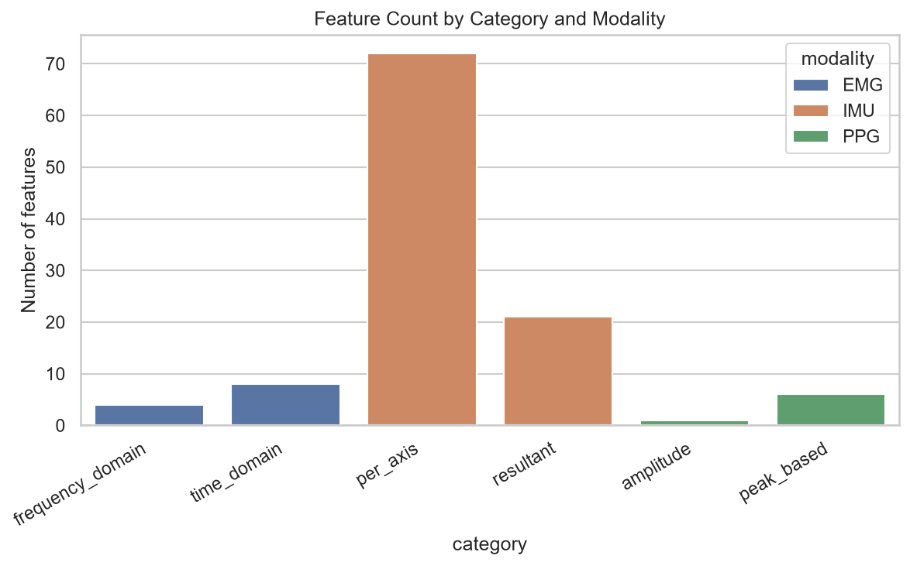
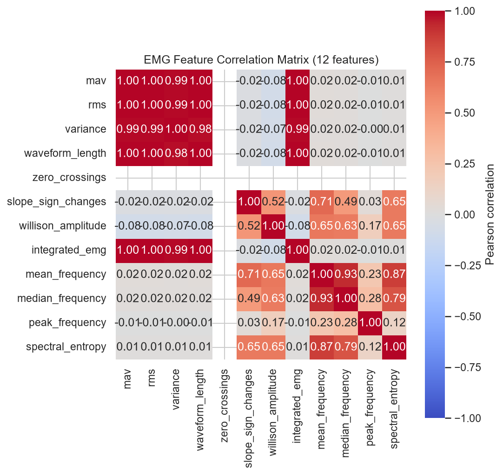
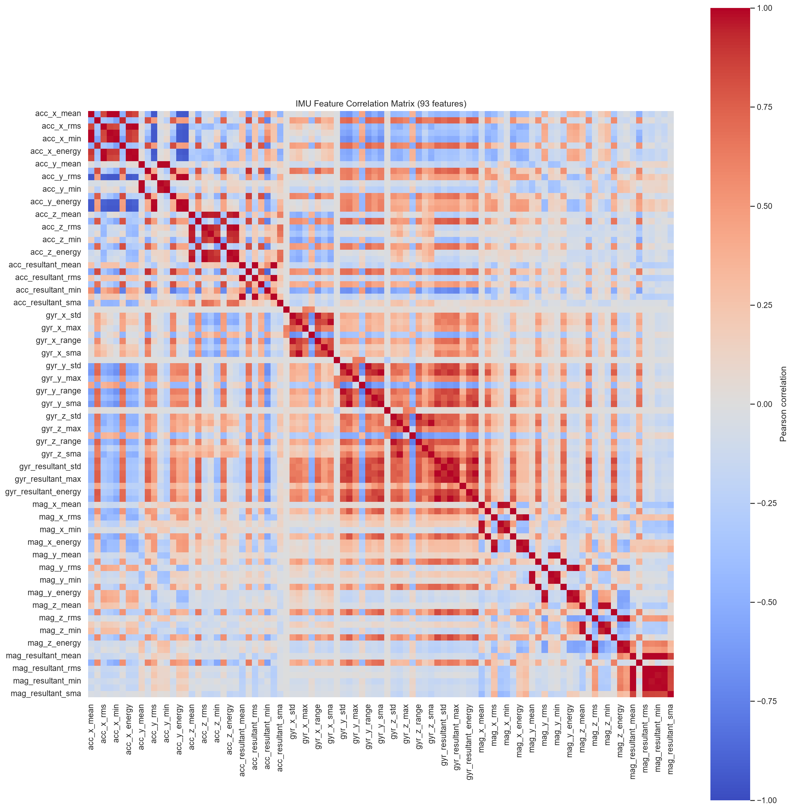
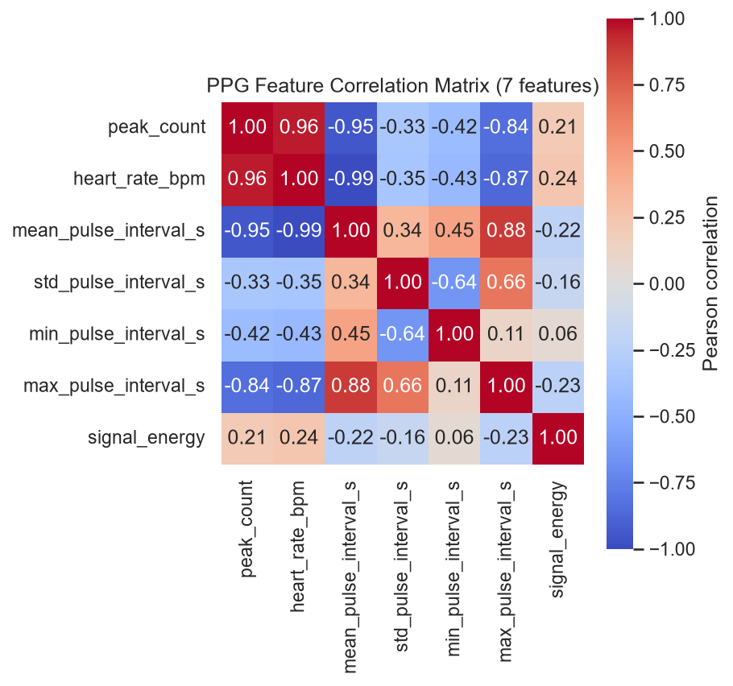
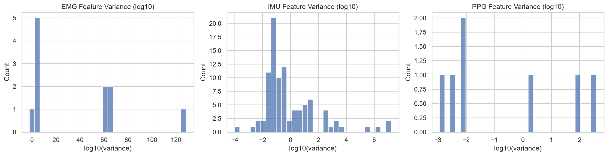
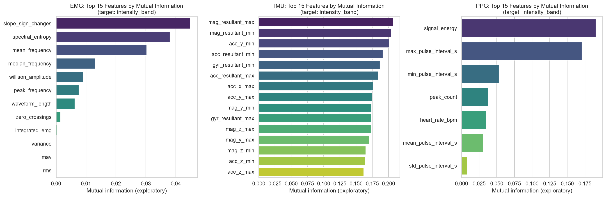

# WSD4FEDSRM -- Feature Validation & Selection Report

**Phase:** 8.5 -- Feature Validation & Selection (no model training, no explainability)

**Reproduce:** `python notebooks/phase8_5_feature_validation_report.py` from the project root (runs Phase 5 load -> Phase 7 preprocess -> Phase 8 feature extraction -> Phase 8.5 validation/selection for subjects P01, P02, P03).

**Configuration used:** near-zero-variance threshold `1e-06`, correlation threshold `0.95`, mutual-info bottom fraction `0.1`, importance target `intensity_band`. All are independently configurable per-call via `FeatureValidationConfig`/`FeatureSelectionConfig`/`FeatureImportanceConfig`.

---

## 1. Dataset Overview

Built from 3 real subjects (P01, P02, P03), all 10 conditions each, using default Phase 7/8 preprocessing and feature-extraction configuration.

| Modality | Windows (rows) | Features (columns) |
|---|---|---|
| EMG | 20076 | 12 |
| IMU | 20054 | 93 |
| PPG | 290 | 7 |

## 2. Data Quality Findings

Beyond the generic missing/infinite/constant/variance/correlation checks (Section 5), this report also runs a distribution-shape-agnostic extreme-outlier scan (robust z-score, median/MAD-based, threshold 100) over every modality's raw feature matrix -- this is a report-level diagnostic only, not part of the reusable `ml.feature_engineering.feature_validation` checks, since it encodes no modality-specific plausible-range assumptions and exists purely to surface candidate raw-data corruption for human review.

### EMG: 10 extreme-outlier window(s) found -- confirmed raw-file corruption

**Independently verified against the raw WSD4FEDSRM source files** (read directly with plain `pandas.read_csv`, no preprocessing/feature-extraction involved): `datasets/raw/WSD4FEDSRM/EMG, IMU, and PPG data/40-50_ internal rotation/Subject 3/EMG data/anterior_deltoid.csv` and `.../infraspinatus.csv` contain raw sample values on the order of 1e28-1e34 mV -- physiologically impossible by many orders of magnitude for surface EMG (normally single-digit mV), yet finite (not NaN/inf), so they pass the infinite-value check silently and only surface via extreme mean/variance statistics or this outlier scan.

| Subject | Condition | Sensor | Window | Feature | Value |
|---|---|---|---|---|---|
| P03 | P03_internal_rotation_40-50 | anterior_deltoid | 0 | variance | 2.060e+66 |
| P03 | P03_internal_rotation_40-50 | infraspinatus | 0 | variance | 8.560e+64 |
| P03 | P03_internal_rotation_40-50 | anterior_deltoid | 1 | variance | 2.499e+54 |
| P03 | P03_internal_rotation_40-50 | infraspinatus | 1 | variance | 3.792e+48 |
| P03 | P03_internal_rotation_40-50 | anterior_deltoid | 2 | variance | 4.298e+33 |
| P03 | P03_internal_rotation_40-50 | infraspinatus | 27 | variance | 3.057e+28 |
| P03 | P03_internal_rotation_40-50 | infraspinatus | 28 | variance | 2.929e+28 |
| P03 | P03_internal_rotation_40-50 | infraspinatus | 11 | variance | 2.295e+28 |
| P03 | P03_internal_rotation_40-50 | infraspinatus | 12 | variance | 2.233e+28 |
| P03 | P03_internal_rotation_40-50 | infraspinatus | 30 | variance | 2.132e+28 |

**Recommendation:** treat these two specific raw files as candidates for exclusion or correction in a future preprocessing revision (e.g. Phase 7's `quality_checks.py` could add a plausible-amplitude-range check for EMG); this report deliberately does not modify, exclude, or impute any data itself.

### IMU: 10 statistical outlier window(s) found -- not confirmed as corruption

Flagged by the same generic robust-outlier scan, but **substantially less extreme and not independently confirmed as a data error**: e.g. `gyr_z_energy` has a dataset median of ~0.73 and a 99.9th percentile of ~216 across all 3 subjects, while the flagged values reach ~350-1400 -- large relative to the rest of the distribution, but nowhere near the 1e28+ scale confirmed for the EMG finding above. This could plausibly reflect a genuine burst of fast rotational movement rather than a sensor artifact; it is reported here for manual review, not asserted as corruption.

| Subject | Condition | Sensor | Window | Feature | Value |
|---|---|---|---|---|---|
| P01 | P01_external_rotation_30-40 | forearm | 148 | gyr_z_energy | 1.100e+03 |
| P01 | P01_external_rotation_30-40 | forearm | 149 | gyr_z_energy | 8.476e+02 |
| P01 | P01_external_rotation_30-40 | hand | 148 | gyr_x_energy | 1.420e+03 |
| P01 | P01_external_rotation_50-60 | hand | 96 | gyr_z_energy | 5.979e+02 |
| P01 | P01_external_rotation_30-40 | hand | 149 | gyr_x_energy | 1.021e+03 |
| P01 | P01_external_rotation_30-40 | forearm | 144 | gyr_z_energy | 4.368e+02 |
| P03 | P03_internal_rotation_30-40 | hand | 0 | gyr_z_energy | 4.195e+02 |
| P01 | P01_external_rotation_30-40 | hand | 144 | gyr_z_energy | 4.111e+02 |
| P01 | P01_external_rotation_50-60 | hand | 2 | gyr_y_energy | 5.929e+02 |
| P01 | P01_external_rotation_30-40 | hand | 143 | gyr_z_energy | 3.528e+02 |

## 3. Feature Statistics

**Caveat:** the extreme-outlier window(s) documented in Section 2 are included, unmodified, in the statistics below -- this is why some means/variances (particularly EMG amplitude features) appear as implausibly large scientific notation. This is a faithful reflection of the raw data as loaded, not a computation error; see Section 2 for the specific offending rows.

### EMG

| Feature | Mean | Std | Min | Max | Variance |
|---|---|---|---|---|---|
| mav | 2.414e+28 | 2.875e+30 | 2.693e-06 | 3.98e+32 | 8.264e+60 |
| rms | 8.938e+28 | 1.073e+31 | 1.493e-05 | 1.489e+33 | 1.151e+62 |
| variance | 1.068e+62 | 1.455e+64 | 2.156e-10 | 2.06e+66 | 2.116e+128 |
| waveform_length | 2.004e+31 | 2.378e+33 | 0.0003108 | 3.288e+35 | 5.654e+66 |
| zero_crossings | 0 | 0 | 0 | 0 | 0 |
| slope_sign_changes | 482.7 | 88.92 | 74 | 673 | 7908 |
| willison_amplitude | 846.1 | 65.95 | 34 | 944 | 4349 |
| integrated_emg | 2.414e+31 | 2.875e+33 | 0.002693 | 3.98e+35 | 8.264e+66 |
| ... | ... | ... | ... | ... | ... | *(+4 more features)* |

### IMU

| Feature | Mean | Std | Min | Max | Variance |
|---|---|---|---|---|---|
| acc_x_mean | 3.802 | 5.56 | -8.957 | 9.894 | 30.91 |
| acc_x_std | 0.2635 | 0.2752 | 0.01585 | 8.265 | 0.07573 |
| acc_x_rms | 5.583 | 3.787 | 0.06163 | 9.895 | 14.34 |
| acc_x_max | 4.451 | 5.258 | -7.885 | 17.09 | 27.65 |
| acc_x_min | 3.153 | 5.917 | -19.03 | 9.831 | 35.01 |
| acc_x_range | 1.298 | 1.329 | 0.07877 | 27.34 | 1.765 |
| acc_x_energy | 4551 | 4016 | 0.3798 | 9792 | 1.613e+07 |
| acc_x_sma | 5.554 | 3.813 | 0.05116 | 9.894 | 14.54 |
| ... | ... | ... | ... | ... | ... | *(+85 more features)* |

### PPG

| Feature | Mean | Std | Min | Max | Variance |
|---|---|---|---|---|---|
| peak_count | 15.24 | 1.458 | 12 | 18 | 2.127 |
| heart_rate_bpm | 91.74 | 8.345 | 67.69 | 111.1 | 69.65 |
| mean_pulse_interval_s | 0.6598 | 0.06388 | 0.54 | 0.8864 | 0.004081 |
| std_pulse_interval_s | 0.03593 | 0.03397 | 0.006182 | 0.2049 | 0.001154 |
| min_pulse_interval_s | 0.5901 | 0.09661 | 0.3 | 0.785 | 0.009333 |
| max_pulse_interval_s | 0.7156 | 0.09147 | 0.575 | 0.97 | 0.008366 |
| signal_energy | 16.74 | 19.41 | 1.633 | 84.03 | 376.6 |

## 4. Feature Correlation Matrices

## 5. Feature Importance Proxies (Exploratory Diagnostics Only)

**These are exploratory screening diagnostics, not final model importance.** Mutual Information and ANOVA F-score are computed independently per feature against a single simple target column (`intensity_band`), ignore feature interactions, and say nothing about a trained model's actual reliance on these features. See `ml/feature_engineering/feature_importance.py` module docstring for the full rationale.

### EMG (target: `intensity_band`, type: categorical)

- 1146 of 20076 row(s) excluded (missing/infinite feature value or missing/inapplicable target 'intensity_band') -- scores computed on complete cases only, not imputed.
- Target 'intensity_band' treated as categorical -- used mutual_info_classif/f_classif.

Top 5 by mutual information: `slope_sign_changes` (0.0449), `spectral_entropy` (0.0381), `mean_frequency` (0.0303), `median_frequency` (0.0132), `willison_amplitude` (0.0090)

### IMU (target: `intensity_band`, type: categorical)

- 1146 of 20054 row(s) excluded (missing/infinite feature value or missing/inapplicable target 'intensity_band') -- scores computed on complete cases only, not imputed.
- Target 'intensity_band' treated as categorical -- used mutual_info_classif/f_classif.

Top 5 by mutual information: `mag_resultant_max` (0.2071), `mag_resultant_min` (0.2042), `acc_y_min` (0.2011), `acc_resultant_min` (0.1913), `gyr_resultant_min` (0.1868)

### PPG (target: `intensity_band`, type: categorical)

- 0 of 290 row(s) excluded (missing/infinite feature value or missing/inapplicable target 'intensity_band') -- scores computed on complete cases only, not imputed.
- Target 'intensity_band' treated as categorical -- used mutual_info_classif/f_classif.

Top 5 by mutual information: `signal_energy` (0.1905), `max_pulse_interval_s` (0.1707), `min_pulse_interval_s` (0.0531), `peak_count` (0.0381), `heart_rate_bpm` (0.0347)

## 6. Selection Recommendations (Not Automatically Applied)

Every recommendation below is produced by `FeatureSelector.recommend` and is **not** acted upon anywhere in this pipeline. Call `feature_selection.apply_recommendations(matrix, recommendations, actions=(...))` yourself to actually drop columns, choosing which recommendation types to act on.

### EMG

- **Recommended for removal (1):**
  - `zero_crossings` -- constant feature (single unique value)
- **Recommended for review (5):**
  - `integrated_emg` -- correlation 1.000 with 'mav' (threshold 0.95)
  - `mav` -- low mutual information (0.0000) with target 'intensity_band' -- among the bottom 10% of EMG features (exploratory only)
  - `rms` -- correlation 1.000 with 'mav' (threshold 0.95)
  - `variance` -- correlation 0.985 with 'mav' (threshold 0.95)
  - `waveform_length` -- correlation 1.000 with 'mav' (threshold 0.95)
- **Retained if 'remove' recommendations were applied:** 11 / 12

### IMU

- **Recommended for removal (0):**
  - none
- **Recommended for review (51):**
  - `acc_resultant_energy` -- correlation 0.997 with 'acc_resultant_mean' (threshold 0.95)
  - `acc_resultant_rms` -- correlation 0.997 with 'acc_resultant_mean' (threshold 0.95)
  - `acc_x_energy` -- correlation 0.987 with 'acc_x_rms' (threshold 0.95)
  - `acc_x_max` -- correlation 0.993 with 'acc_x_mean' (threshold 0.95)
  - `acc_x_min` -- correlation 0.995 with 'acc_x_mean' (threshold 0.95)
  - `acc_x_sma` -- correlation 1.000 with 'acc_x_rms' (threshold 0.95)
  - `acc_y_energy` -- correlation 0.988 with 'acc_y_rms' (threshold 0.95)
  - `acc_y_max` -- correlation 0.991 with 'acc_y_mean' (threshold 0.95)
  - `acc_y_min` -- correlation 0.992 with 'acc_y_mean' (threshold 0.95)
  - `acc_y_range` -- correlation 0.952 with 'acc_y_std' (threshold 0.95)
  - `acc_y_sma` -- correlation 1.000 with 'acc_y_rms' (threshold 0.95)
  - `acc_z_energy` -- correlation 0.977 with 'acc_z_rms' (threshold 0.95)
  - `acc_z_min` -- correlation 0.959 with 'acc_z_mean' (threshold 0.95)
  - `acc_z_rms` -- correlation 0.967 with 'acc_z_mean' (threshold 0.95)
  - `acc_z_sma` -- correlation 0.970 with 'acc_z_mean' (threshold 0.95)
  - `acc_z_std` -- low mutual information (0.0074) with target 'intensity_band' -- among the bottom 10% of IMU features (exploratory only)
  - `gyr_resultant_max` -- correlation 0.960 with 'gyr_resultant_std' (threshold 0.95)
  - `gyr_resultant_rms` -- correlation 0.993 with 'gyr_resultant_mean' (threshold 0.95)
  - `gyr_resultant_sma` -- correlation 0.996 with 'gyr_resultant_mean' (threshold 0.95)
  - `gyr_x_range` -- correlation 0.963 with 'gyr_x_std' (threshold 0.95)
  - `gyr_x_sma` -- correlation 0.991 with 'gyr_x_rms' (threshold 0.95)
  - `gyr_y_mean` -- low mutual information (0.0000) with target 'intensity_band' -- among the bottom 10% of IMU features (exploratory only)
  - `gyr_y_range` -- correlation 0.977 with 'gyr_y_std' (threshold 0.95)
  - `gyr_y_sma` -- correlation 0.993 with 'gyr_y_rms' (threshold 0.95)
  - `gyr_z_mean` -- low mutual information (0.0053) with target 'intensity_band' -- among the bottom 10% of IMU features (exploratory only)
  - `gyr_z_range` -- correlation 0.972 with 'gyr_z_std' (threshold 0.95)
  - `gyr_z_sma` -- correlation 0.992 with 'gyr_z_rms' (threshold 0.95)
  - `gyr_z_std` -- low mutual information (0.0044) with target 'intensity_band' -- among the bottom 10% of IMU features (exploratory only)
  - `mag_resultant_energy` -- correlation 0.995 with 'mag_resultant_mean' (threshold 0.95)
  - `mag_resultant_max` -- correlation 0.993 with 'mag_resultant_mean' (threshold 0.95)
  - `mag_resultant_min` -- correlation 0.993 with 'mag_resultant_mean' (threshold 0.95)
  - `mag_resultant_rms` -- correlation 1.000 with 'mag_resultant_mean' (threshold 0.95)
  - `mag_resultant_std` -- low mutual information (0.0028) with target 'intensity_band' -- among the bottom 10% of IMU features (exploratory only)
  - `mag_x_energy` -- correlation 0.960 with 'mag_x_rms' (threshold 0.95)
  - `mag_x_max` -- correlation 0.980 with 'mag_x_mean' (threshold 0.95)
  - `mag_x_min` -- correlation 0.976 with 'mag_x_mean' (threshold 0.95)
  - `mag_x_range` -- correlation 0.995 with 'mag_x_std' (threshold 0.95)
  - `mag_x_sma` -- correlation 0.998 with 'mag_x_rms' (threshold 0.95)
  - `mag_x_std` -- low mutual information (0.0049) with target 'intensity_band' -- among the bottom 10% of IMU features (exploratory only)
  - `mag_y_energy` -- correlation 0.966 with 'mag_y_rms' (threshold 0.95)
  - `mag_y_max` -- correlation 0.992 with 'mag_y_mean' (threshold 0.95)
  - `mag_y_min` -- correlation 0.992 with 'mag_y_mean' (threshold 0.95)
  - `mag_y_range` -- correlation 0.991 with 'mag_y_std' (threshold 0.95)
  - `mag_y_sma` -- correlation 0.999 with 'mag_y_rms' (threshold 0.95)
  - `mag_y_std` -- low mutual information (0.0055) with target 'intensity_band' -- among the bottom 10% of IMU features (exploratory only)
  - `mag_z_energy` -- correlation 0.967 with 'mag_z_rms' (threshold 0.95)
  - `mag_z_max` -- correlation 0.983 with 'mag_z_mean' (threshold 0.95)
  - `mag_z_min` -- correlation 0.983 with 'mag_z_mean' (threshold 0.95)
  - `mag_z_range` -- correlation 0.994 with 'mag_z_std' (threshold 0.95)
  - `mag_z_sma` -- correlation 0.999 with 'mag_z_rms' (threshold 0.95)
  - `mag_z_std` -- low mutual information (0.0045) with target 'intensity_band' -- among the bottom 10% of IMU features (exploratory only)
- **Retained if 'remove' recommendations were applied:** 93 / 93

### PPG

- **Recommended for removal (0):**
  - none
- **Recommended for review (3):**
  - `heart_rate_bpm` -- correlation 0.959 with 'peak_count' (threshold 0.95)
  - `mean_pulse_interval_s` -- correlation -0.953 with 'peak_count' (threshold 0.95)
  - `std_pulse_interval_s` -- low mutual information (0.0081) with target 'intensity_band' -- among the bottom 10% of PPG features (exploratory only)
- **Retained if 'remove' recommendations were applied:** 7 / 7

**Overall:** 112 total features across all modalities; 1 recommended for removal, 59 flagged for review, 111 would remain if only 'remove' recommendations were applied. No features were actually removed by this report.
