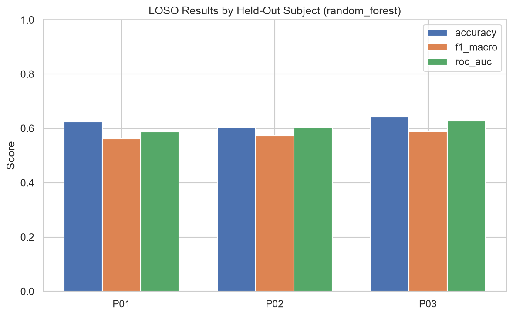
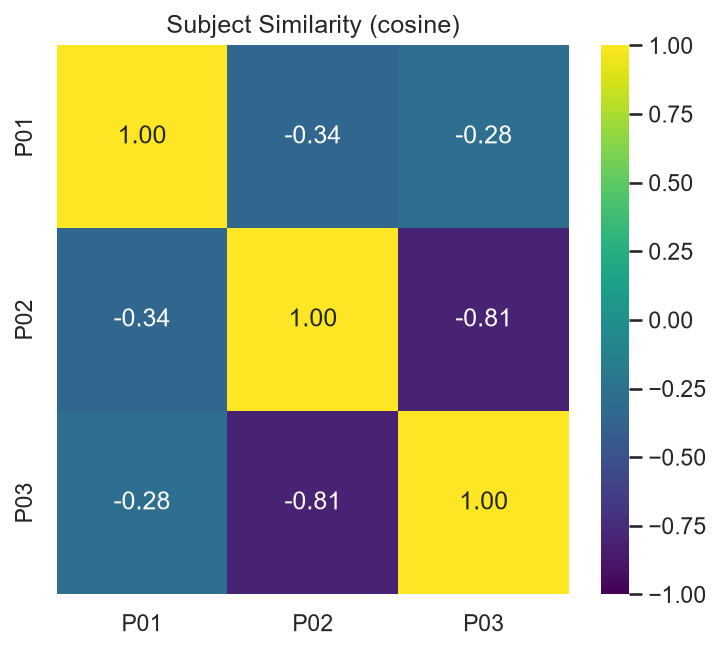
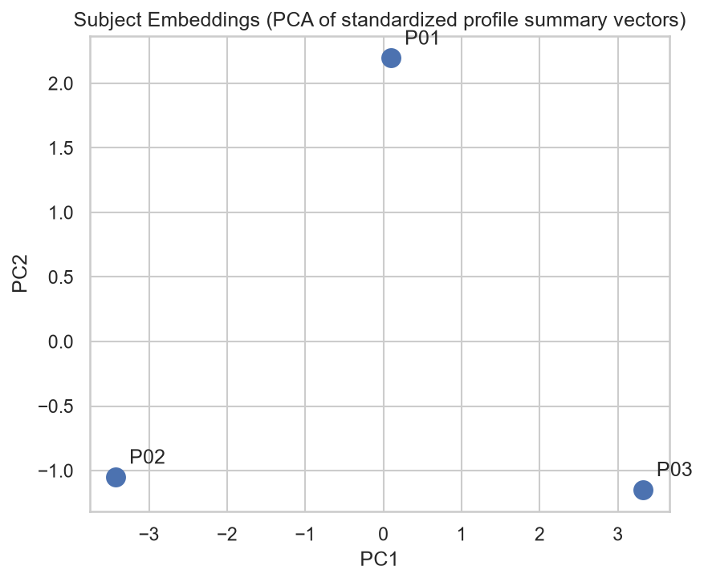
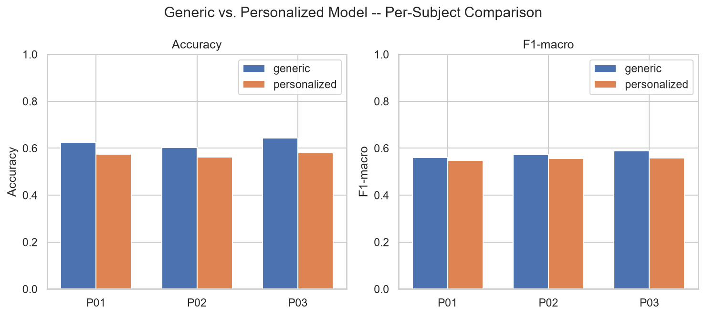
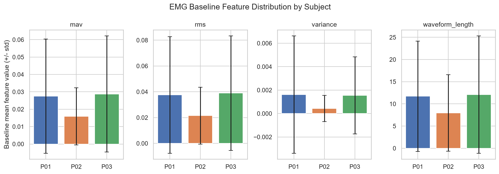

# WSD4FEDSRM -- Personalization Report

**Phase:** 12 -- Personalization Framework (LOSO evaluation, subject baselines, personalized prediction, similarity search; consumed directly by Phase 13's agentic framework -- no agentic reasoning here)

**Reproduce:** `python notebooks/phase12_personalization_report.py` from the project root (took 99.1s on this machine, CPU only).

## 1. Overview

This phase implements a modular personalization framework (`ml.personalization/`) that adapts fatigue prediction to individual subjects, evaluated over the same bounded, documented 3-subject demo (P01, P02, P03) Phases 9-11 used. It reuses Phase 5's raw `Subject` loader (demographics/anthropometrics), Phase 8.5's `FeatureDataset`s (EMG baseline statistics, fatigue history), and Phase 9's classical model builders/evaluation utilities (`evaluate_model`, `ClassificationMetrics`) throughout -- no preprocessing or feature engineering is duplicated.

Four capabilities are covered: (1) **subject profiles** combining demographics, anthropometrics, per-modality baseline statistics, and fatigue history; (2) **Leave-One-Subject-Out (LOSO) cross-validation**, training on all-but-one subject and testing on the held-out one, repeated for every subject; (3) a **personalization layer** blending each LOSO fold's "generic" (population, minus this subject) prediction with a subject-baseline deviation signal; and (4) **subject similarity search** over profile summary vectors.

## 2. Subject Profile Overview

Built via `build_subject_profile()`, combining Phase 5's demographic/anthropometric records with per-subject baseline statistics and fatigue history derived from Phase 8.5's EMG/IMU/PPG feature matrices.

| Subject | Age | Height (cm) | Mass (kg) | BMI | Mean RPE | Fatigue trials | EMG windows | IMU windows | PPG windows |
|---|---|---|---|---|---|---|---|---|---|
| P01 | 31 | 165.0 | 56.8 | 20.9 | 14.4 | 6 | 5610 | 5610 | 79 |
| P02 | 23 | 163.0 | 55.9 | 21.1 | 13.8 | 6 | 7530 | 7530 | 109 |
| P03 | 26 | 183.0 | 80.7 | 24.1 | 14.8 | 6 | 6936 | 6914 | 102 |

## 3. LOSO Evaluation

`evaluate_loso()` trained a fresh `random_forest` per fold (2 training subjects, 1 held-out test subject) via `sklearn.model_selection.LeaveOneGroupOut`, reusing `ml.models.common.evaluation.evaluate_model` for metrics unmodified.

| Held-out subject | Trained on | Accuracy | Precision | Recall | F1 | ROC-AUC | PR-AUC |
|---|---|---|---|---|---|---|---|
| P01 | P02, P03 | 0.625 | 0.568 | 0.561 | 0.561 | 0.586 | 0.708 |
| P02 | P01, P03 | 0.604 | 0.581 | 0.574 | 0.573 | 0.604 | 0.672 |
| P03 | P01, P02 | 0.643 | 0.588 | 0.591 | 0.589 | 0.627 | 0.762 |
| **mean** | -- | **0.624** | **0.579** | **0.575** | **0.574** | **0.606** | **0.714** |

## 4. Personalized Prediction Results

`predict_personalized()` blends each held-out window's generic (LOSO-fold) probability with a subject-baseline deviation signal: `personalized = alpha * generic + (1 - alpha) * deviation` (alpha=0.6). The deviation signal is the mean absolute z-score of the window's raw EMG features against *that subject's own* baseline mean/std (`baseline_builder.ModalityBaseline`), squashed through a logistic function (scale=1.0, midpoint=1.0).

Representative sample predictions (first 5 held-out windows per subject):

| Subject | Global probability | Baseline deviation | Deviation probability | Personalized probability | Personalized class |
|---|---|---|---|---|---|
| P01 | 0.908 | 0.395 | 0.353 | 0.686 | 1 |
| P01 | 0.624 | 0.303 | 0.332 | 0.507 | 1 |
| P01 | 0.740 | 0.473 | 0.371 | 0.592 | 1 |
| P01 | 0.701 | 0.518 | 0.382 | 0.573 | 1 |
| P01 | 0.633 | 0.638 | 0.410 | 0.544 | 1 |
| P02 | 0.355 | 0.601 | 0.401 | 0.374 | 0 |
| P02 | 0.596 | 0.643 | 0.412 | 0.522 | 1 |
| P02 | 0.656 | 1.469 | 0.615 | 0.640 | 1 |
| P02 | 0.716 | 1.401 | 0.599 | 0.669 | 1 |
| P02 | 0.148 | 1.660 | 0.659 | 0.353 | 0 |
| P03 | 0.668 | 0.609 | 0.404 | 0.562 | 1 |
| P03 | 0.041 | 0.828 | 0.457 | 0.207 | 0 |
| P03 | 0.183 | 0.989 | 0.497 | 0.309 | 0 |
| P03 | 0.292 | 0.772 | 0.443 | 0.353 | 0 |
| P03 | 0.577 | 0.521 | 0.382 | 0.499 | 0 |

## 5. Similarity Analysis

`find_similar_subjects()` over each profile's standardized `summary_vector` (metric=cosine), covering demographics, anthropometrics, fatigue history, and per-modality baseline levels.

*Note on the scores below:* with only 3 subjects, standardizing each column forces it to sum to (approximately) zero across the population, so any two subjects' standardized vectors are mathematically likely to disagree in sign on several dimensions -- cosine similarity being negative here is an expected small-N standardization artifact, not a sign of a broken computation; the *ranking* between candidates remains meaningful even though the absolute scores are not directly comparable to a larger-population run.

Most similar subjects to **P01**:

| Rank | Subject | Similarity |
|---|---|---|
| 1 | P03 | -0.283 |
| 2 | P02 | -0.336 |

Most similar subjects to **P02**:

| Rank | Subject | Similarity |
|---|---|---|
| 1 | P01 | -0.336 |
| 2 | P03 | -0.808 |

Most similar subjects to **P03**:

| Rank | Subject | Similarity |
|---|---|---|
| 1 | P01 | -0.283 |
| 2 | P02 | -0.808 |

## 6. Performance Comparison

| Subject | Generic Accuracy | Personalized Accuracy | Generic F1 | Personalized F1 | Accuracy Δ | F1 Δ | ROC-AUC Δ |
|---|---|---|---|---|---|---|---|
| P01 | 0.625 | 0.574 | 0.561 | 0.548 | -0.051 | -0.014 | +0.002 |
| P02 | 0.604 | 0.563 | 0.573 | 0.556 | -0.041 | -0.017 | -0.015 |
| P03 | 0.643 | 0.581 | 0.589 | 0.558 | -0.062 | -0.031 | -0.012 |
| **mean** | -- | -- | -- | -- | **-0.051** | **-0.021** | **-0.008** |

## 7. Discussion

Personalization changed mean F1-macro by -0.021 and mean accuracy by -0.051 across the 3 held-out subjects, improving F1 for 0/3 of them. The personalization layer is deliberately simple (a baseline-deviation blend, not a second trained model) so its behavior is directly attributable: a subject whose held-out windows look statistically unlike their own historical baseline gets pulled toward the positive (fatigued) class regardless of what the generic model says, which only helps when that deviation signal actually correlates with true fatigue for that subject -- exactly the kind of per-subject behavior LOSO's already-severe inter-subject variability (Section 3) predicts will vary.

## 8. Limitations

- **Bounded subject count (3)**, identical to Phases 9-11 -- LOSO with 3 subjects trains each fold on only 2 subjects, the smallest non-degenerate case; this demonstrates the framework end-to-end, not final LOSO generalization performance.
- **The personalization layer is a heuristic blend, not a learned combiner** -- `alpha` was chosen once, not tuned or validated against a held-out personalization-specific split.
- **Baseline statistics use a subject's *entire* window history** (including the very windows LOSO evaluates on), since Phase 12's 3-subject demo has no spare data for a separate baseline-calibration split -- a production deployment should calibrate each subject's baseline from an initial period before relying on personalized predictions for that subject.
- **Similarity search compares only the fixed 10-dimensional summary vector**, not the full per-feature baseline -- a coarser representation chosen for cross-subject comparability, not the richest possible one.
- **No agentic reasoning** -- this phase's outputs (profiles, LOSO results, personalized predictions, similarity) are designed to be consumed by Phase 13's agentic framework, not to implement it.
