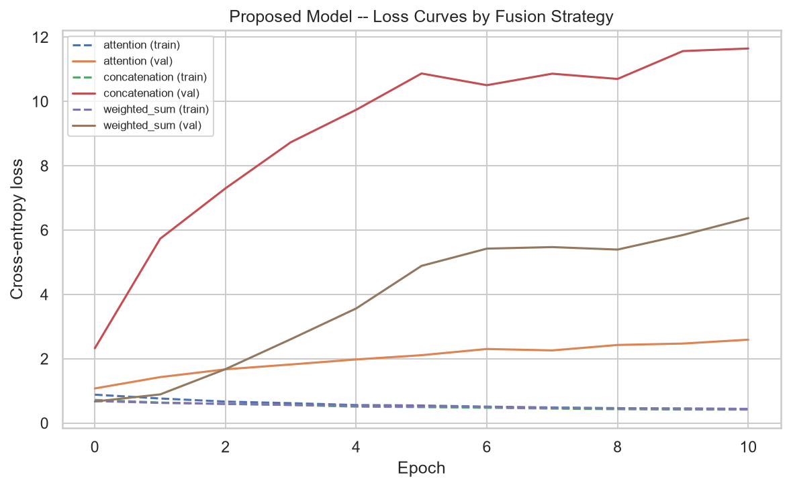
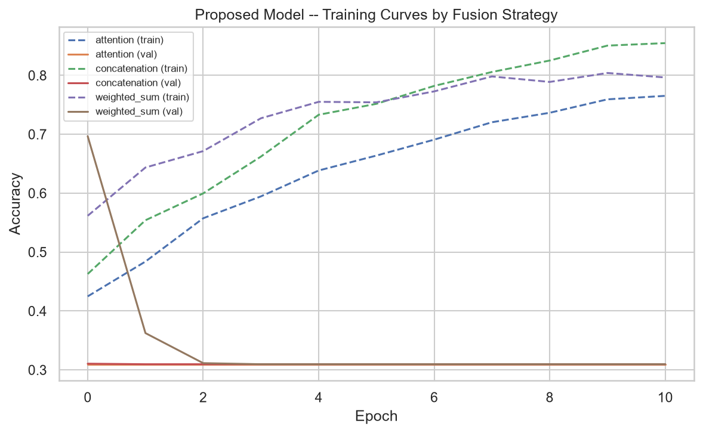
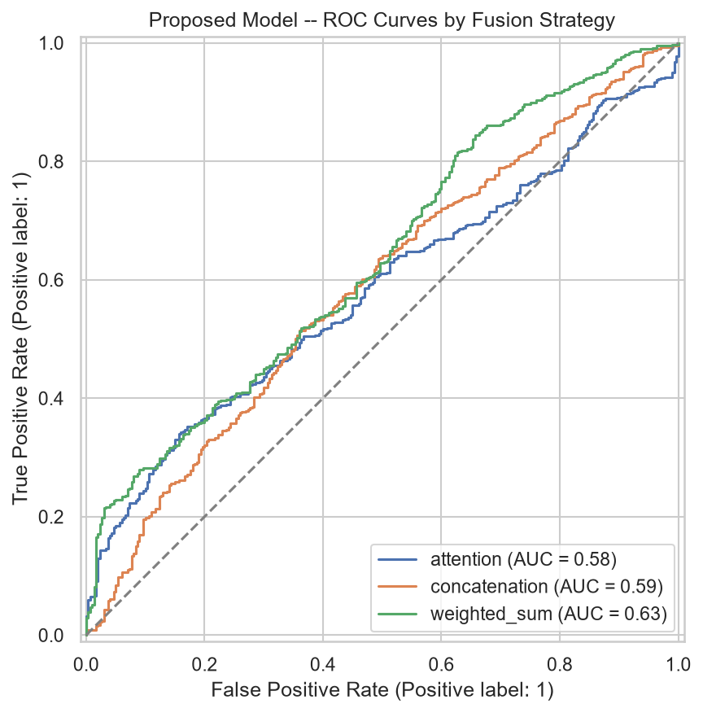
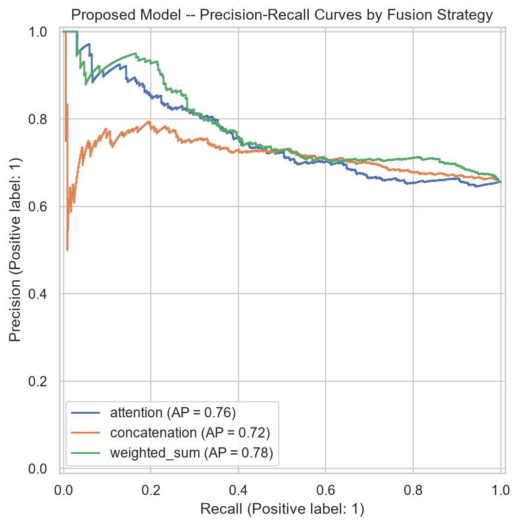
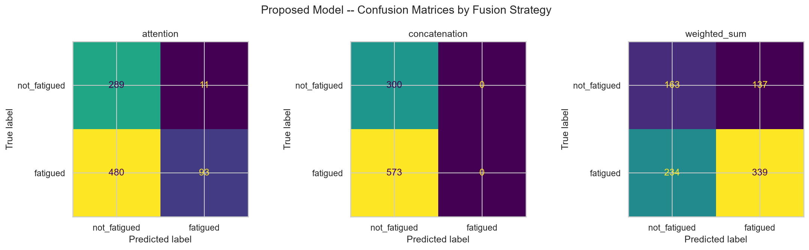
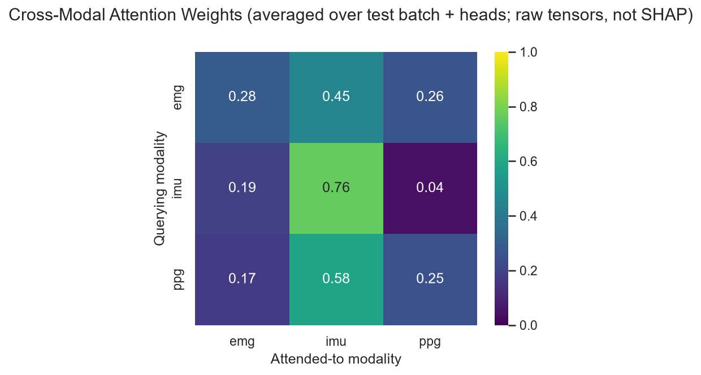
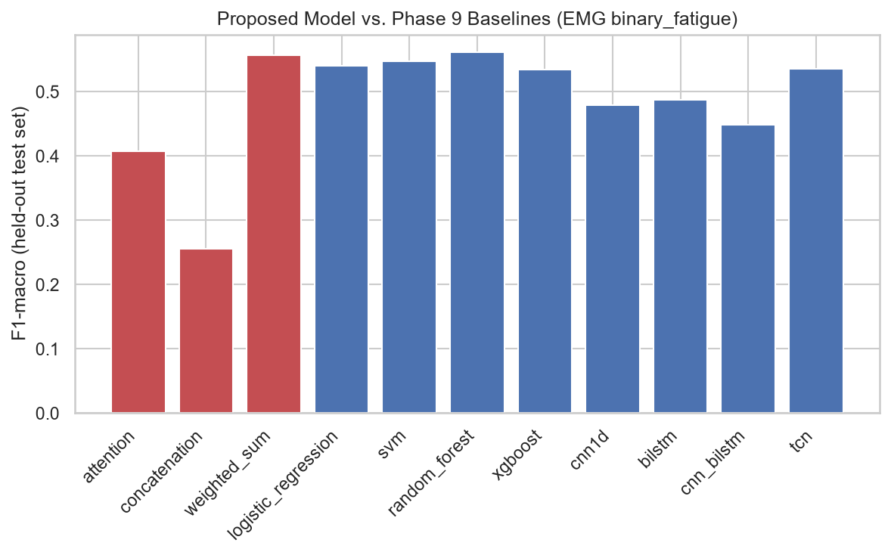

# WSD4FEDSRM -- Proposed Multimodal Fusion Model Report

**Phase:** 10 -- Proposed Model (novel multimodal architecture only; no SHAP, personalization, or agentic AI -- later phases)

**Reproduce:** `python notebooks/phase10_proposed_model_report.py` from the project root (runs Phases 5-10 for subjects P01, P02, P03; took 2.8 minutes on this machine, CPU only).

---

## 1. Architecture

Independent MLP encoders per modality (EMG/IMU/PPG) project each modality's Phase 8 feature vector to a shared 32-dimensional embedding. A configurable fusion module then combines the three embeddings into one unified representation via one of three strategies -- **multi-head cross-modal attention (default)**, concatenation, or a learned weighted sum -- fed to a classification head. See `docs/proposed_model.md` and each module's docstring (`ml/models/proposed/`) for full design rationale.

```
EMG features (72-d)  -> EMGEncoder -> embedding (32-d) --\
IMU features (558-d) -> IMUEncoder -> embedding (32-d) ---> FusionModule -> ClassificationHead -> logits
PPG features (7-d)   -> PPGEncoder -> embedding (32-d) --/
```

## 2. Dataset

Built by aligning Phase 8.5's per-modality EMG/IMU/PPG feature datasets into shared multimodal samples (`ml.models.common.multimodal_dataset_builder`) for subjects P01, P02, P03: EMG 72 features (6 muscles), IMU 558 features (6 locations), PPG 7 features, 3155 aligned samples (191 MVIC-calibration windows excluded -- no Borg RPE label).

EMG and IMU windows are matched directly (they share Phase 8's default 1.0s/50%-overlap window config); PPG's much coarser 10.0s windows are matched to each EMG/IMU window by nearest center time, so several consecutive EMG/IMU windows legitimately share one PPG window's features -- see the module docstring for why this alignment step is Phase 10's job, not a carry-over gap.

**Split:** group-aware by subject_id (train/val/test = 0.7/0.15/0.15, seed=42) -- 1184/1098/873 samples. `RobustScaler` fit on the training portion only.

## 3. Hyperparameters

**Deliberately small and heavily regularized** relative to what a full-dataset run would use -- see Section 6/7: with only 3 demo subjects, a group-aware split puts exactly one subject in each of train/val/test, and a larger-capacity model was found to overfit its single training subject within a handful of epochs (verified: train accuracy reached 97% while validation loss simultaneously *increased* every epoch from the very first). These hyperparameters are sized for this bounded demo, not a recommendation for the full 34-subject run.

| Component | Configuration |
|---|---|
| EMG encoder | hidden=(16,), output=8, dropout=0.5, BatchNorm |
| IMU encoder | hidden=(32,), output=8, dropout=0.5, BatchNorm |
| PPG encoder | hidden=(8,), output=8, dropout=0.3, BatchNorm |
| Attention fusion | embed_dim=8, heads=2, layers=1, dropout=0.2 |
| Classifier | hidden=(8,), dropout=0.5, BatchNorm |
| Loss | Cross-entropy, class-weighted (inverse frequency) |
| Training | Adam, lr=0.0005, weight_decay=0.01, batch=64, early stopping patience=10, ReduceLROnPlateau, seed=42 |
| Device | cpu (mixed precision enabled only if CUDA) |

## 4. Results

### 4a. Fusion strategy comparison (held-out test set)

| Fusion strategy | Epochs | Accuracy | Precision | Recall | F1 | ROC-AUC | PR-AUC | Train (s) |
|---|---|---|---|---|---|---|---|---|
| attention | 11 | 0.438 | 0.635 | 0.563 | 0.408 | 0.581 | 0.756 | 3.7 |
| concatenation | 11 | 0.344 | 0.172 | 0.500 | 0.256 | 0.588 | 0.718 | 2.7 |
| weighted_sum | 11 | 0.575 | 0.561 | 0.567 | 0.557 | 0.634 | 0.779 | 3.0 |











### 4b. Cross-modal attention weights (raw tensors -- SHAP-based explainability is a later phase)



## 5. Comparison Against Phase 9 Baseline Models

Phase 9's numbers below are restated from `reports/baseline_models_report.md` (EMG, all features, binary_fatigue, held-out test set) rather than re-computed here: Phase 9's per-modality dataset (one row per sensor-window) and Phase 10's fused multimodal dataset (one row per aligned multimodal window) are built by genuinely different pipelines and are not expected to contain identical rows. Both use the same 3 subjects and the same group-aware split methodology (seed=42), which is what makes this comparison meaningful despite not being row-identical.

| Model | Category | Accuracy | Precision | Recall | F1 | ROC-AUC |
|---|---|---|---|---|---|---|
| **proposed (attention)** | multimodal fusion | 0.438 | 0.635 | 0.563 | 0.408 | 0.581 |
| **proposed (concatenation)** | multimodal fusion | 0.344 | 0.172 | 0.500 | 0.256 | 0.588 |
| **proposed (weighted_sum)** | multimodal fusion | 0.575 | 0.561 | 0.567 | 0.557 | 0.634 |
| logistic_regression | classical | 0.560 | 0.544 | 0.548 | 0.540 | 0.570 |
| svm | classical | 0.588 | 0.547 | 0.547 | 0.547 | 0.563 |
| random_forest | classical | 0.625 | 0.568 | 0.561 | 0.561 | 0.586 |
| xgboost | classical | 0.664 | 0.606 | 0.553 | 0.535 | 0.598 |
| cnn1d | deep_learning | 0.660 | 0.598 | 0.527 | 0.479 | 0.574 |
| bilstm | deep_learning | 0.659 | 0.594 | 0.530 | 0.487 | 0.568 |
| cnn_bilstm | deep_learning | 0.660 | 0.607 | 0.517 | 0.449 | 0.575 |
| tcn | deep_learning | 0.672 | 0.626 | 0.557 | 0.536 | 0.604 |



## 6. Discussion

Best proposed-model variant: **weighted_sum** fusion (F1-macro=0.557). Best Phase 9 baseline: **random_forest** (F1-macro=0.561).
The proposed multimodal model does **not yet outperform** the best Phase 9 single-modality baseline on this 3-subject demonstration subset. Given the very small training set for a model with substantially more parameters than any Phase 9 baseline, this is an expected data-scale limitation (see Limitations), not evidence against the fusion hypothesis -- the architecture should be re-evaluated once trained on the full 34-subject dataset.

**A concrete, verified explanation for this limitation:** with only 3 subjects, the group-aware split assigns exactly one subject per split -- train=['P02'], val=['P03'], test=['P01']. Since `RobustScaler` is fit on the training subject only (correct practice -- no leakage), the held-out subjects' scaled feature distributions differ sharply from what the model was trained on: scaled train std=1.07 vs. scaled test std=6.08 vs. scaled val std=11.70. Training on one subject's idiosyncratic EMG/IMU/PPG scale and evaluating on a different subject's is an extreme version of exactly the inter-subject variability problem the upcoming **Personalization (leave-one-subject-out)** phase exists to address -- this finding is additional, concrete motivation for that phase, not a defect in this one.

## 7. Limitations

- **Bounded subject count (3)**, identical to Phase 9 -- results demonstrate the architecture trains and evaluates correctly end-to-end, not final performance.
- **Baseline comparison is not row-identical** (see Section 5) -- a methodologically sound but not perfectly matched comparison.
- **Feature imputation and scaling** follow the same dataset-wide (not per-fold) simplification documented in Phase 9/`dataset_builder.py`.
- **No hyperparameter tuning** was performed for any fusion strategy; hidden sizes/embedding dimension were chosen once, not searched.
- **PPG's coarser-window alignment is approximate** (nearest-center-time, not exact containment) -- documented in `multimodal_dataset_builder.py`.
- **Attention weights are shown as raw tensors only** (Section 4b) -- proper SHAP-based feature attribution is Phase 11's job, not this phase's.

## 8. Recommendations for Later Phases

1. Re-run across the full 34-subject dataset before drawing performance conclusions.
2. SHAP explainability (next phase) should consume the `modality_embeddings`/`attention_weights`/`fused_embedding` this model already exposes via `ModelOutput` -- no architecture changes should be needed.
3. Personalization (LOSO) can reuse `ml.models.common.data_splitter` unmodified (group-aware by subject_id, as designed since Phase 9).
4. Consider a learning-rate/architecture search once full-dataset compute budget is available.
